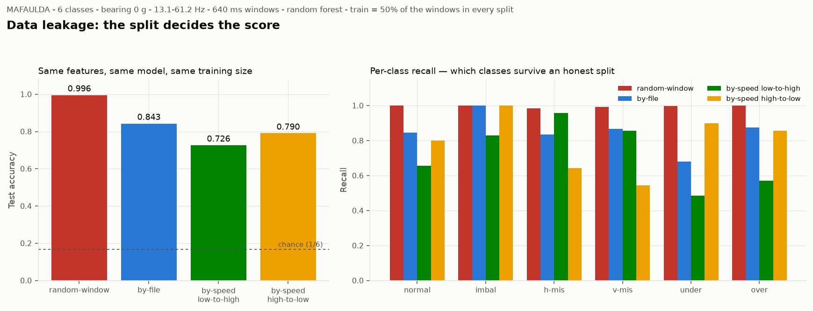

# สรุปผลการดำเนินงาน — Edge AI-Based Predictive Maintenance for Electrical & Machine Systems

โครงงานสหกิจศึกษา · ช่วงที่ 1: ศึกษาทฤษฎีและทดลองกับชุดข้อมูลสาธารณะ
ปรับปรุงล่าสุด 2026-10-05

---

## บทสรุป

โครงงานนี้พัฒนาระบบตรวจจับความผิดปกติของเครื่องจักรที่**ประมวลผล AI บน edge device
โดยตรง** ไม่ส่งข้อมูลดิบขึ้น cloud ทั้งหมด ขอบเขตที่ตั้งไว้คือ ISO 13374 ชั้น 1–2
(ตรวจจับความผิดปกติ และวินิจฉัยว่าผิดปกติแบบใด)

เนื่องจาก**บริษัทยังไม่ได้กำหนดเครื่องจักรเป้าหมาย** ช่วงแรกจึงใช้ชุดข้อมูลสาธารณะ
MAFAULDA เป็นสนามทดลอง เพื่อสร้างวิธีการและเครื่องมือที่จะนำไปใช้กับเครื่องจริงต่อไป

### ผลสำคัญ 8 ข้อ

| # | ผลที่ได้ | ความสำคัญ |
|---|---|---|
| 1 | **พบว่าเอกสารของชุดข้อมูลระบุ sampling rate ผิด** จาก 50,000 เป็น 51,200 Hz | แกนความถี่ของการวิเคราะห์ทุกชิ้นคลาดไป 2.4% ถ้าไม่พบ · ต่อมาพิสูจน์ซ้ำด้วยวิธีที่ไม่อ่านข้อมูลเลย ดู §4.1 |
| 2 | **วัดขนาดของ data leakage ได้เป็นตัวเลข** ความแม่นยำต่างกัน 27 จุดเพราะวิธีแบ่งข้อมูลอย่างเดียว | เป็นหลักฐานว่าตัวเลขความแม่นยำที่ไม่ระบุวิธีแบ่งข้อมูลนั้นไม่มีความหมาย |
| 3 | **หาลายเซ็นของความเสียหายได้ 7 จาก 8 ชนิด** พร้อมระบุระดับความเชื่อมั่นของแต่ละตัว | เป็นฐานของการวินิจฉัยชั้นที่ 2 |
| 4 | **สร้างเครื่องมือสำรวจข้อมูลเชิงโต้ตอบ 2 ตัว** | ใช้ซ้ำได้กับข้อมูลจากเครื่องจริงในอนาคต |
| 5 | **ระบุข้อจำกัดของชุดข้อมูลไว้ชัดเจน** เช่น ความถี่ความเสียหายของตลับลูกปืนไม่เคยเป็นพีคเด่นเลย | ป้องกันการสรุปผิดและการเสียเวลาไล่ตามสิ่งที่เป็นไปไม่ได้ |
| 6 | **วางระบบรับส่งข้อมูลครบเส้นทาง** MQTT → InfluxDB → Grafana 13 แผง ทดสอบแล้วข้อความถึง 100% | พิสูจน์ว่าสถาปัตยกรรมที่ออกแบบไว้ทำงานได้จริง ไม่ใช่แค่บนกระดาษ |
| 7 | **สร้างตัวตรวจจับที่เทรนจากข้อมูลปกติเท่านั้น** recall 0.913 · เตือนผิด 0 จาก 47 ตัวอย่าง · 3 ชั้น | เป็นสถานการณ์เดียวกับหน้างานจริงที่ไม่มีตัวอย่างความเสียหายให้เทรน |
| 8 | **ทบทวนวรรณกรรม 11 ฉบับที่ใช้ชุดข้อมูลเดียวกัน** ปิดคำถามได้ 5 จาก 7 ข้อ | ตอบคำท้วงของอาจารย์ว่ารู้ได้อย่างไรว่าวิธีที่ใช้ถูกต้อง |

### สถานะตามแผน

| ขั้น | สถานะ |
|---|---|
| Checkpoint 1 — ตั้งค่า Raspberry Pi | ✅ เสร็จ |
| Checkpoint 2 — ทดลองกับ MAFAULDA | ✅ เสร็จครบ 6 ข้อ |
| Checkpoint 3 — วาง data pipeline (MQTT / InfluxDB / Grafana) | 🔨 **เสร็จ 5 จาก 6 ข้อ** เหลือย้ายขึ้น Pi |
| Checkpoint 4 — ต่อเซ็นเซอร์จริง | ⬜ รอบริษัทกำหนดเครื่องจักร |
| งานแทรก — ทบทวนวรรณกรรม | ✅ อ่านแล้ว 11 ฉบับ |

ผลงานรวม ณ 2026-10-05

| | จำนวน |
|---|---:|
| บันทึกการทดลองใน `experiments/` | 14 ฉบับ |
| เอกสารใน `docs/` และ `paper/` | 7 ฉบับ |
| กราฟใน `reports/` | 14 ใบ |
| โค้ดใน `src/` (ไม่นับ `__init__.py`) | 30 ไฟล์ |

> **เอกสารฉบับนี้ครอบคลุมถึง Checkpoint 2 เป็นหลัก** ส่วน Checkpoint 3
> สรุปไว้ใน §13 และมีรายละเอียดเต็มใน `docs/data-pipeline-design.md`
> กับบันทึกการทดลองวันที่ 2026-09-28 และ 2026-10-04

---

## 1. โจทย์และขอบเขต

### 1.1 เป้าหมาย

ระบบตรวจจับและพยากรณ์ความผิดปกติของอุปกรณ์ไฟฟ้าและเครื่องจักร โดยให้ edge device
เรียนรู้รูปแบบการทำงานปกติ แล้วแจ้งเตือนเมื่อพบสัญญาณผิดปกติ**ก่อน**อุปกรณ์เสียหายจริง

### 1.2 ขอบเขตที่เป็นไปได้จริง

อ้างอิงมาตรฐาน ISO 13374 ซึ่งแบ่งความสามารถของระบบติดตามสภาพเครื่องจักรเป็นชั้น

| ชั้น | ความสามารถ | ในโครงงานนี้ |
|---|---|---|
| 1 | ตรวจจับว่าผิดปกติ (anomaly detection) | ✅ อยู่ในขอบเขต |
| 2 | วินิจฉัยว่าผิดปกติแบบใด (diagnostics) | ✅ อยู่ในขอบเขต |
| 3 | พยากรณ์อายุที่เหลือ (RUL) | ⚠️ ทำได้บนชุดข้อมูลสาธารณะเท่านั้น |

ชั้นที่ 3 ต้องการข้อมูลที่ติดตามเครื่องจักรตั้งแต่เริ่มเสื่อมจนเสียจริง ซึ่งการเก็บ
ระหว่างสหกิจไม่กี่เดือนทำไม่ได้

### 1.3 สถาปัตยกรรมเป้าหมาย

```
เครื่องจักร → เซ็นเซอร์ + ESP32 → (คำนวณ feature บนบอร์ด)
                                      ↓ MQTT ส่ง JSON ก้อนเล็ก
                          Raspberry Pi 5 → InfluxDB → Grafana
                                      ↓
                              โมเดล inference → แจ้งเตือน
```

**ไม่ส่งสัญญาณดิบตลอดเวลา** เก็บเฉพาะช่วงที่พบความผิดปกติ หรือสุ่มเก็บไว้เทรนซ้ำ
เหตุผลคือทั้งข้อจำกัดของเครือข่ายและอายุของ microSD บน Raspberry Pi

---

## 2. สภาพแวดล้อมการทำงาน

### 2.1 เครื่องพัฒนา — โน้ตบุ๊ก Windows

ใช้พัฒนาและทดลองทั้งหมด เพราะมีพื้นที่เก็บชุดข้อมูลเต็ม 31 GB และประมวลผลเร็วกว่า

### 2.2 เครื่องปลายทาง — Raspberry Pi 5

RAM 16 GB · microSD 64 GB · Raspberry Pi OS Lite 64-bit · Docker · Python venv
เข้าถึงจากที่ใดก็ได้ผ่าน Tailscale

**ข้อจำกัดสำคัญ: ห้ามนำชุดข้อมูลเต็มลง Pi** เพราะ microSD 64 GB รับไม่ไหว
(31 GB หลังแตกไฟล์ บวกกับระบบปฏิบัติการและพื้นที่ทำงาน)

### 2.3 หลักการเขียนโค้ดให้รันได้ทั้งสองเครื่อง

- ไม่ hardcode path ใช้ `pathlib` และอ่านค่าจาก `config.yaml` ผ่าน `src/paths.py`
- แยก profile ของแต่ละเครื่องไว้ในไฟล์ config เดียวกัน
- ค่าคงที่ที่สำคัญ (sampling rate, ชื่อคอลัมน์, ตัวคูณความถี่ความเสียหาย)
  อ่านจาก config เสมอ ห้ามเขียนตายในโค้ด

---

## 3. ชุดข้อมูล MAFAULDA

### 3.1 ที่มาและเหตุผลที่เลือก

Machinery Fault Database จาก Universidade Federal do Rio de Janeiro บันทึกจากเครื่อง
SpectraQuest Machinery Fault Simulator รุ่น Alignment-Balance-Vibration

เลือกแทนชุดข้อมูล CWRU ที่นิยมกว่า เพราะ MAFAULDA มี**การสั่นสะเทือน เสียง และ
ความเร็วรอบ อยู่ในชุดเดียวกัน** ซึ่งตรงกับรายการข้อมูลที่โครงงานกำหนดไว้

### 3.2 โครงสร้าง

ไฟล์ CSV ไม่มีหัวตาราง 250,000 แถว × 8 คอลัมน์ ต่อไฟล์

| คอลัมน์ | ชื่อในโค้ด | ตำแหน่ง |
|---|---|---|
| 0 | `tach` | Tachometer (พัลส์วัดรอบ) |
| 1–3 | `u_axial` `u_radial` `u_tang` | ตลับลูกปืน **underhang** (ระหว่างมอเตอร์กับโรเตอร์) |
| 4–6 | `o_axial` `o_radial` `o_tang` | ตลับลูกปืน **overhang** (นอกโรเตอร์ ฝั่งตรงข้ามมอเตอร์) |
| 7 | `mic` | ไมโครโฟน |

ทิศทาง: **axial** = ขนานเพลา · **radial** = ตั้งฉากพุ่งออกจากแกน · **tangential** = ตามทิศหมุน

### 3.3 จำนวนไฟล์ (ตรวจกับไฟล์จริงแล้วตรงทุกตัว)

| สภาวะ | จำนวน | ระดับความรุนแรง |
|---|---:|---|
| Normal | 49 | — |
| Horizontal misalignment | 197 | 0.50 / 1.00 / 1.50 / 2.00 mm |
| Vertical misalignment | 301 | 0.51 / 0.63 / 1.27 / 1.40 / 1.78 / 1.90 mm |
| Imbalance | 333 | 6 / 10 / 15 / 20 / 25 / 30 / 35 g |
| Underhang bearing | 558 | ball 186 / cage 188 / outer race 184 |
| Overhang bearing | 513 | ball 137 / cage 188 / outer race 188 |
| **รวม** | **1,951** | |

โฟลเดอร์ของ bearing fault มีชั้นย่อยเป็นมวลถ่วงอีกชั้น (`0g` / `6g` / `20g` / `35g`)
รวมชุดที่ไม่มีมวลถ่วงเลย **295 ไฟล์ คิดเป็น 27.5%** ของไฟล์ bearing ทั้งหมด

---

## 4. 🚩 การตรวจสอบชุดข้อมูล — พบเอกสารต้นทางผิด 4 จุด

**นี่คือผลงานที่สำคัญที่สุดของช่วงแรก** เพราะถ้าไม่ตรวจ ทุกอย่างที่ทำต่อจากนั้นจะผิดหมด
โดยไม่มีสัญญาณเตือนใดๆ

| สิ่งที่เอกสารต้นทางระบุ | ค่าที่ถูกต้อง | วิธีพิสูจน์ |
|---|---|---|
| sampling rate 50,000 Hz | **51,200 Hz** | นับความเร็วรอบจาก tachometer เทียบกับชื่อไฟล์ |
| ไฟล์ยาว 5.0 วินาที | **4.8828 วินาที** | 250,000 ÷ 51,200 |
| มีความเสียหายที่รางใน (inner race) | **ไม่มี** มีแค่ ball / cage / outer race | ตรวจชื่อโฟลเดอร์จริง |
| vertical misalignment 17.8 mm | **1.78 mm** | ตรวจชื่อโฟลเดอร์จริง |

และยืนยันเพิ่มอีกหนึ่งข้อที่เอกสารไม่ได้ระบุชัด: **ค่าในไฟล์เป็นหน่วย g (ความเร่ง
โน้มถ่วง) ไม่ใช่แรงดันไฟฟ้า** พิสูจน์โดยพบค่าสูงสุด 8.489 ซึ่งเกินพิสัย ±5 V ของ
เครื่องบันทึก NI 9234

### 4.1 รายละเอียดการพิสูจน์ sampling rate

สมมติค่า sampling rate หลายค่า แล้วคำนวณความเร็วรอบจากสัญญาณ tachometer
เทียบกับความเร็วที่ระบุในชื่อไฟล์ ซึ่งเป็น ground truth

| sampling rate ที่สมมติ | อัตราส่วน วัดได้/ชื่อไฟล์ | คลาดจาก 1.000 |
|---:|---:|---:|
| 50,000 Hz | 0.976650 | **−2.33%** |
| 51,000 Hz | 0.996198 | −0.38% |
| **51,200 Hz** | **1.000089** | **+0.009%** ✅ |
| 51,712 Hz | 1.010106 | +1.01% |

วัดจาก 1,718 ไฟล์ที่สัญญาณ tachometer สะอาดพอ และ**ทุกคลาสได้ 1.000 เท่ากันหมด**

**หลักฐานสนับสนุน** 51.2 kHz คือ sampling rate สูงสุดของเครื่องบันทึก NI 9234
ซึ่งอยู่ในรายการอุปกรณ์ของชุดข้อมูลเอง และ 50000 ÷ 51200 = 0.976562 ซึ่งตรงกับ
อัตราส่วนที่วัดได้ 0.976650 แทบพอดี

### 4.2 บทเรียนเชิงวิธีการ

ตอนแรกพบว่าความเร็วที่วัดได้ต่ำกว่าชื่อไฟล์ **2.33% อย่างเป็นระบบ** แล้วสรุปว่าเป็น
**slip ของมอเตอร์เหนี่ยวนำ** ซึ่งเป็นคำอธิบายที่ฟังดูสมเหตุสมผลมากในทางวิศวกรรม
แต่**ผิด**

> **ส่วนต่างที่เป็นระบบและคงที่ ชี้ไปที่ค่าคงที่ตัวใดตัวหนึ่งที่ใส่ผิด
> ให้ไล่ตรวจค่าคงที่ในสมการก่อน แล้วค่อยไปอธิบายด้วยปรากฏการณ์ทางฟิสิกส์**

ตัวแยกแยะที่ชัดที่สุดคือ **ถ้าเป็น slip จริง คลาสที่มีมวลถ่วง 35 g ต้อง slip มากกว่า
คลาสที่ไม่มีมวลถ่วง** แต่ของจริงทุกคลาสได้ 1.000 เท่ากันหมด

บันทึกเต็ม: `experiments/2026-09-20-sampling-rate.md`

---

## 5. การวัดความเร็วรอบจาก tachometer

ความเร็วรอบเป็นข้อมูลที่ขาดไม่ได้ เพราะความถี่ความเสียหายทุกตัวเป็น**ตัวคูณ**ของ
ความเร็วรอบ ถ้าวัดความเร็วผิด ตำแหน่งที่ไปค้นหาความเสียหายก็ผิดตาม

สัญญาณ tachometer เป็นพัลส์ที่เกิดเมื่อแถบสะท้อนแสงบนเพลาผ่านหน้าเซ็นเซอร์
หลักการคือนับพัลส์แล้วหารด้วยเวลา แต่ในทางปฏิบัติพบกับดัก 3 ข้อ

### 5.1 กับดักที่ 1 — พัลส์กว้างมาก ไม่ใช่จุดเดียว

วัดจริงแล้วพัลส์กว้าง **2.4–8.9 มิลลิวินาที** ซึ่งที่ความเร็วต่ำสุดคิดเป็น **443 แถว**
ถ้านับทุกแถวที่สูงกว่าเกณฑ์ว่าเป็นหนึ่งพัลส์ จะได้ความเร็ว **6,300 Hz แทนที่จะเป็น
29 Hz คือเกินจริง 214 เท่า**

ความกว้างของพัลส์เข้ากับแบบจำลอง `width_ms = 0.817 + 100.1/f` ได้เกือบสมบูรณ์
ตีความได้ว่าแถบสะท้อนแสงกินมุมประมาณ **10% ของเส้นรอบวง** บวกเวลาตอบสนอง
คงที่ของวงจรอีก **0.82 มิลลิวินาที**

**วิธีแก้** ตรวจจับเฉพาะ**ขอบขาขึ้น** ด้วย Schmitt trigger ที่ใช้เกณฑ์สองค่า

### 5.2 กับดักที่ 2 — พัลส์หยักกลางพัลส์ ทำให้นับซ้ำ

ในไฟล์ที่เครื่องสั่นแรง (กระจุกตัวที่ความเสียหายแบบ ball fault) สัญญาณตกต่ำกว่าเกณฑ์
ชั่วขณะกลางพัลส์ แล้วถูกนับเป็นสองขอบ ช่วงห่างที่ได้จึงสลับสั้น-ยาว
**ความเร็วที่คำนวณได้พุ่งไปถึง 1,111 Hz แทนที่จะเป็น 59 Hz คือผิด 18 เท่า**

พบในไฟล์ราว **7% ของชุดข้อมูล (135 จาก 1,951 ไฟล์)**

**วิธีแก้** ใช้ **refractory period** คือทิ้งขอบที่อยู่ใกล้ขอบก่อนหน้าเกินกว่าจะเป็น
รอบถัดไปได้จริง โดยระยะขั้นต่ำมาจากขีดจำกัดเชิงฟิสิกส์ (เพลาหมุนไม่เกิน 70 Hz)
**ไม่ได้มาจากตัวข้อมูลเอง** ซึ่งสำคัญ เพราะถ้าใช้ค่าจากข้อมูลจะกลายเป็นการปรับจูน
ให้เข้ากับข้อมูลชุดนี้เท่านั้น

### 5.3 กับดักที่ 3 — มัธยฐานของช่วงห่างไม่ใช่ตัวประมาณที่ดีที่สุด

วิธีที่ให้ผลดีกว่าคือนับว่าทั้งช่วงตั้งแต่ขอบแรกถึงขอบสุดท้ายกินไปกี่รอบ
แล้วหารด้วยเวลาที่ใช้ทั้งหมด

```python
revs = np.maximum(np.round(np.diff(edges) / np.median(np.diff(edges))), 1)
rot_hz = fs * revs.sum() / (edges[-1] - edges[0])
```

ความคลาดเคลื่อนของตำแหน่งขอบแต่ละอันหักล้างกันเองเมื่อวัดจากปลายถึงปลาย เหลือเพียง
ความคลาดของขอบแรกกับขอบสุดท้าย ส่วนการปัดเป็นจำนวนรอบเต็มทำให้ทนต่อพัลส์ที่หายไปด้วย

ในไฟล์ที่มีปัญหา วิธีนี้ให้ค่าคลาดจากที่คาดเพียง **0.13%** ขณะที่วิธีมัธยฐานคลาด **1.4%**

### 5.4 ผลการตรวจสอบ

ทดสอบกับไฟล์ชุด normal ทั้ง 49 ไฟล์ โดยใช้ชื่อไฟล์เป็น ground truth

| ตัวชี้วัด | ผล |
|---|---|
| ผ่านเกณฑ์ ±1% | **49 จาก 49 ไฟล์** |
| อัตราส่วนวัดได้/ชื่อไฟล์ | 0.99704–1.00738 (มัธยฐาน 1.00062) |
| ความแกว่งภายในไฟล์ | 0.209% |

**ทักษะทั้งสามข้อนี้ใช้ซ้ำได้ตรงๆ** กับเซ็นเซอร์ TCRT5000 ต่อกับ ESP32 ใน Checkpoint 4
เพราะเป็นปัญหาของหลักการวัด ไม่ใช่ของชุดข้อมูลนี้

บันทึกเต็ม: `experiments/2026-09-20-tachometer-validation.md`

---

## 6. การสำรวจข้อมูลเบื้องต้น

สร้างกราฟ 12 ใบใน `reports/eda/` พร้อมคำอธิบายใน `reports/eda/README.md`

| กลุ่มกราฟ | สิ่งที่แสดง |
|---|---|
| `00a`–`00d` | สัญญาณดิบทั้ง 6 ช่องเซ็นเซอร์ แยกตามกลุ่มความเสียหาย |
| `01`–`05` | สัญญาณดิบ · สเปกตรัม · envelope spectrum · การกระจายของ feature · กับดัก imbalance |
| `06`–`07` | envelope floor และคำอธิบายวิธี envelope analysis |
| `08` | ผลการทดลองเรื่อง data leakage |

### สิ่งที่เห็นด้วยตาเปล่า

- **imbalance 35 g เห็นคลื่นไซน์ชัดเจน** ในสัญญาณดิบ ส่วนความเสียหายอื่นแทบดูไม่ออก
- **สเปกตรัมธรรมดาแยก imbalance ได้** (พีคที่ 1× สูงกว่าปกติ 8 เท่า)
- ⚠️ **แต่แยก misalignment ไม่ได้เลยบนช่อง `u_radial`** ซึ่งเป็นช่องที่กราฟ 01–05
  ใช้ทั้งหมด ต้องย้ายไปดู**อัตราส่วนพีค 2×/1× บนช่อง `o_tang`** แทน

> **บทเรียน: การเลือกช่องเซ็นเซอร์สำคัญพอๆ กับการเลือก feature**
> ความเสียหายบางชนิดมองไม่เห็นเลยถ้าดูผิดช่อง

---

## 7. feature ที่ใช้

สกัด **12 ปริมาณ × 6 ช่องเซ็นเซอร์ = 72 ค่า** ต่อหนึ่งไฟล์ ทุกตัวเบาพอที่จะคำนวณ
บนไมโครคอนโทรลเลอร์ได้ ซึ่งเป็นข้อกำหนดของสถาปัตยกรรมเป้าหมาย

| กลุ่ม | feature | วัดอะไร |
|---|---|---|
| โดเมนเวลา | `p2p` `rms` `crest` `kurt` | ความแรงและความแหลมของสัญญาณ |
| โดเมนความถี่ | `h1_frac` `r21` `e_low` `e_mid` `e_high` | พลังงานกระจายอยู่ที่ความถี่ใด |
| Envelope | `kurt_band` `env_floor` `env_rel` | จังหวะและปริมาณการกระแทก |

**นิยาม สูตร ค่าอ้างอิง และกับดักของแต่ละตัว อยู่ในเอกสารแยก**
`docs/feature-reference.md`

ตารางค่าของทุกไฟล์เก็บที่ `data/processed/feature_grid.csv` (1,951 แถว × 79 คอลัมน์)
ใช้เวลาคำนวณ 15.5 นาที

---

## 8. การหาลายเซ็นของความเสียหาย

### 8.1 วิธีการ — 2 ขั้น

**ขั้นที่ 1 ให้ข้อมูลเลือกเอง** ไล่ทุกค่าผสม 66 ชุด (11 feature × 6 ช่อง) แล้ววัดว่า
แต่ละชุดแยกกลุ่มหนึ่งออกจาก**ทุกกลุ่มอื่น**ได้ดีเพียงใด ด้วยค่า AUC แบบ one-vs-rest

**เหตุผลที่ไม่เลือกด้วยทฤษฎีตั้งแต่แรก** เคยทำแล้วผิดมาก่อน — สรุปว่า `envelope floor`
แยกความเสียหายของตลับลูกปืนได้ เพราะทดสอบกับ normal และ bearing สามชนิดตามที่ตำราแนะนำ
พอเพิ่ม misalignment เข้าไป พบว่า h-misalignment ที่ 2.0 mm ให้ค่า **สูงกว่า outer race
ทุกกลุ่ม** ข้อสรุปจึงใช้ไม่ได้

> **บทเรียน: ก่อนสรุปว่า feature หนึ่งแยกคลาส A ได้ ต้องทดสอบกับทุกคลาสที่มี
> ไม่ใช่เฉพาะคลาสที่สนใจ**

**ขั้นที่ 2 กรองด้วยเกณฑ์ที่ AUC บอกไม่ได้** เพราะแต่ละกลุ่มย่อยน่าจะถูกบันทึกรวดเดียว
ในการติดตั้งครั้งเดียว อะไรก็ตามที่ต่างกันระหว่างรอบบันทึกจะแยกกลุ่มได้ขาด 100%
โดยไม่เกี่ยวกับความเสียหาย **ค่า AUC = 1.00 จึงพิสูจน์อะไรไม่ได้**

ลายเซ็นที่ใช้ได้จริงต้องผ่านอย่างน้อยหนึ่งข้อ

1. **คงอยู่ข้ามรอบบันทึก** — ความเสียหายของตลับลูกปืนมีบันทึกที่มวลถ่วง 0/6/20/35 g
   ซึ่งเป็นคนละรอบ ถ้าเป็นผลของรอยแตกจริงต้องเห็นทุกระดับ
2. **เปลี่ยนตามความรุนแรงอย่างเป็นระบบ** — imbalance ตามมวล, misalignment ตามระยะเยื้อง

**มี 4 ตัวที่ค่า AUC สูงมากแต่ไม่ผ่านขั้นที่ 2 และถูกตัดทิ้ง** ตัวอย่างที่ชัดที่สุดคือ
overhang cage ได้ AUC 1.00 เต็ม แต่ทิศทาง**กลับหัวกับฟิสิกส์** คือเงียบกว่าเครื่องปกติ
5 เท่า ซึ่งรอยแตกไม่ควรทำให้เครื่องเงียบลง

### 8.2 ผลลัพธ์

| ความเสียหาย | ลายเซ็น | ผลที่วัดได้ | สถานะ |
|---|---|---|---|
| Imbalance | `u_radial.h1_frac` | เพิ่มตามมวล 2.9 → 13.6 เท่า | ✅ |
| Overhang outer race | `u_radial.env_rel` | 1.34–1.37 เท่า ทุกระดับมวล | ✅ |
| Underhang ball | `o_axial.rms` | 5–12 เท่า ทุกระดับมวล | ✅ |
| Overhang ball | `o_radial.e_high` | ใกล้ศูนย์ ทุกระดับมวล | ✅ |
| Underhang outer race | `o_axial.e_high` | 9.5 เท่าที่ 0 g จางลงเมื่อเติมมวล | 🟡 |
| Underhang cage | `u_tang.kurt` | 1.7–1.9 เท่าที่ 0 และ 6 g | 🟡 |
| Misalignment (ทั้งสองแบบ) | `o_tang.r21` | สูงกว่าปกติทุกระดับ 1.6–6.1 เท่า | 🟡 |
| Overhang cage | — | ยังไม่พบ | ❌ |

### 8.3 ⚠️ ข้อจำกัดที่ต้องระบุในรายงาน

**ลายเซ็นที่ทฤษฎีอธิบายได้มีเพียง 2 จาก 7 ตัว**

| ลายเซ็น | ทฤษฎีอธิบายได้ | เหตุผล |
|---|---|---|
| Imbalance → `h1_frac` | ✅ | มวลถ่วงหมุนครบรอบ 1 ครั้งต่อการหมุน 1 รอบ จึงสร้างแรงที่ความถี่ 1× ล้วน |
| Misalignment → `r21` | ✅ | คัปปลิ้งถูกบีบและคลาย 2 ครั้งต่อรอบ พลังงานจึงย้ายไป 2× |
| Underhang cage → `kurt` | 🟡 | รังลูกปืนหลวมทำให้กระแทกไม่เป็นจังหวะ ซึ่ง kurtosis จับได้ |
| อีก 4 ตัว | ❌ | ยังไม่ทราบกลไก |

และพบรูปแบบที่น่ากังวล: **4 จาก 7 ลายเซ็นอยู่คนละฝั่งกับความเสียหาย** เช่นความเสียหาย
ที่ตลับลูกปืนฝั่ง underhang แต่สัญญาณแรงที่สุดปรากฏที่เซ็นเซอร์ฝั่ง overhang
มีสองคำอธิบายที่เป็นไปได้และ**ยังแยกไม่ได้**

1. การสั่นส่งผ่านเพลาและฐานไปอีกฝั่งจริง ซึ่งเป็นไปได้ในทางกลศาสตร์
2. เป็นร่องรอยของรอบการบันทึก เพราะแต่ละคลาสต้องถอดประกอบเครื่องใหม่

**นัยสำคัญ: ลายเซ็นที่ยังไม่มีคำอธิบายเชิงกลไก อาจย้ายไปใช้กับเครื่องจักรอื่นไม่ได้**

บันทึกเต็ม: `experiments/2026-09-22-signature-screen.md`
และ `experiments/2026-09-22-signature-persistence.md`

---

## 9. 🚩 การทดลองเรื่อง data leakage

**เป็นผลงานที่นำไปใช้อ้างอิงได้กว้างที่สุด** เพราะเป็นปัญหาของงาน machine learning
ทุกงาน ไม่เฉพาะงานนี้

### 9.1 คำถาม

ตัวเลขความแม่นยำที่รายงานออกมา เปลี่ยนไปเท่าใดเมื่อ**เปลี่ยนแค่วิธีแบ่งข้อมูล
train/test** โดยที่ feature โมเดล และจำนวนข้อมูลที่ใช้เทรนเหมือนกันทุกประการ

### 9.2 การทดลอง

ข้อมูล 6 คลาส · 120 ไฟล์ · ตัดเป็นหน้าต่าง 640 มิลลิวินาที · 66 feature ·
random forest 300 ต้น · **ทุกวิธีเทรนด้วยข้อมูล 50% เท่ากัน**

| วิธีแบ่ง | ความแม่นยำ | ข้อมูลรั่วทางไหน |
|---|---:|---|
| สุ่มหน้าต่าง (random shuffle) | **0.996** | หน้าต่างที่ติดกันจากไฟล์เดียวกันไปอยู่ทั้งสองฝั่ง |
| แบ่งตามไฟล์ | **0.843** | ยังอยู่ในรอบบันทึกเดียวกัน และยังเห็นความเร็วรอบเดียวกัน |
| แบ่งตามความเร็ว (เทรนต่ำ ทดสอบสูง) | **0.726** | — |
| แบ่งตามความเร็ว (เทรนสูง ทดสอบต่ำ) | **0.790** | — |
| เดาสุ่ม | 0.167 | |



### 9.3 ข้อสรุป

**ความแม่นยำหายไป 27 จุดเพราะเปลี่ยนวิธีแบ่งข้อมูลอย่างเดียว**

1. ตัวเลข 0.996 ไม่ได้วัดความสามารถในการจับความเสียหาย แต่วัด**ความสามารถในการ
   จำรอบบันทึก** หน้าต่างสองอันที่ห่างกัน 0.64 วินาทีในไฟล์เดียวกัน มาจากเครื่อง
   ตัวเดียวกัน ความเร็วเดียวกัน การประกอบเดียวกัน
2. **ต้องรายงานวิธีแบ่งข้อมูลคู่กับความแม่นยำเสมอ** ตัวเลขลอยๆ ไม่มีความหมาย
3. **ทิศทางไม่สมมาตร** เทรนที่ความเร็วสูงแล้วทดสอบที่ความเร็วต่ำ (0.790) ดีกว่า
   ทิศกลับกัน (0.726) เพราะที่ความเร็วสูงความเสียหายถูกกระตุ้นแรงกว่า
   → **ถ้าเก็บข้อมูลเทรนได้ช่วงเดียว ให้เก็บตอนเครื่องทำงานหนัก**
4. ⚠️ **แม้การแบ่งตามไฟล์ก็ยังสูงเกินจริง** เพราะไฟล์ในกลุ่มย่อยเดียวกันน่าจะบันทึก
   รวดเดียว การแบ่งที่ซื่อสัตย์ที่สุดต้องข้ามรอบบันทึกหรือข้ามเครื่องจักร
   ซึ่งชุดข้อมูลนี้ทำไม่ได้

**คลาสที่รอดทุกวิธีคือ imbalance** (recall 0.83–1.00) ตรงกับลายเซ็นที่ยืนยันแล้ว
ส่วน bearing ทั้งสองฝั่งตกหนักที่สุดและไปสับสนกับ misalignment

บันทึกเต็ม: `experiments/2026-09-25-split-leakage.md`

---

## 10. ข้อจำกัดของชุดข้อมูลที่ค้นพบ

ส่วนนี้สำคัญเพราะเป็นสิ่งที่**ป้องกันการเสียเวลาไล่ตามสิ่งที่เป็นไปไม่ได้**

### 10.1 ความถี่ความเสียหายของตลับลูกปืนไม่เคยเป็นพีคเด่นเลย

ตำรา condition monitoring สอนว่าความเสียหายของตลับลูกปืนจะปรากฏเป็นพีคที่ความถี่
เฉพาะใน envelope spectrum (BPFO สำหรับรางนอก, BSF สำหรับลูกปืน, FTF สำหรับรัง)

ตรวจไฟล์ `ball_fault` ที่ไม่มีมวลถ่วง **ทั้ง 51 ไฟล์** แล้วดูว่าพีคใหญ่ที่สุดอยู่ที่ใด

| พีคใหญ่ที่สุดอยู่ที่ | จำนวนไฟล์ |
|---|---:|
| 3× ของความเร็วรอบ | 20 |
| 2× | 14 |
| 1× | 10 |
| 10× | 6 |
| 5× | 1 |
| **BSF (ความถี่ของลูกปืน)** | **0** |

**ไม่มีไฟล์ใดเลยที่พีคเด่นตกที่ความถี่ความเสียหาย ทุกไฟล์เป็นฮาร์มอนิกของความเร็วรอบ**
และการเติมมวลถ่วงก็ไม่ช่วย

**ผลเชิงปฏิบัติ: ห้ามใช้ความสูงของพีคที่ BPFO/BSF/FTF เป็นหลักฐานของความเสียหาย
ในชุดข้อมูลนี้** ต้องใช้ปริมาณที่วัดทั้งแถบแทน

### 10.2 BPFO แยกจากฮาร์มอนิกที่ 3 ไม่ได้ในทุกความเร็ว

ตัวคูณ BPFO ของตลับลูกปืนรุ่นนี้คือ 2.9980 ซึ่งห่างจาก 3.0000 เพียง 0.002

| ความเร็วรอบ | ระยะห่าง BPFO กับ 3× | ความละเอียด FFT | แยกได้ไหม |
|---|---:|---:|---|
| 12.288 Hz | 0.025 Hz | 0.2048 Hz | ❌ |
| 30 Hz | 0.060 Hz | 0.2048 Hz | ❌ |
| 61.44 Hz | 0.123 Hz | 0.2048 Hz | ❌ |

ไฟล์ยาว 4.8828 วินาทีให้ความละเอียดความถี่ 0.2048 Hz ตายตัว ซึ่งหยาบกว่าระยะห่าง
ที่ต้องแยกอย่างน้อย 1.7 เท่าในทุกความเร็ว **พีคทั้งสองตกลงในช่องความถี่เดียวกันเสมอ**

เนื่องจากเครื่องจักรปกติทุกเครื่องมีฮาร์มอนิกของความเร็วรอบอยู่แล้ว **การพบพีคที่
ตำแหน่ง BPFO จึงไม่ใช่หลักฐานของความเสียหายที่รางนอก**

### 10.3 กับดักเรื่องข้อมูลที่ต้องระวัง

| # | กับดัก | ผลถ้าไม่ระวัง |
|---|---|---|
| 1 | **มวลถ่วงปนอยู่ในไฟล์ bearing fault** ผู้จัดทำเติมมวลถ่วงเพื่อขยายสัญญาณ | โมเดลเรียนรู้ "มีมวลถ่วงไหม" แทน "ตลับลูกปืนเสียไหม" |
| 2 | **กรองด้วย `mass_g == 0` จะตัดคลาส imbalance ทิ้งทั้งคลาส** เพราะ imbalance ไม่มีไฟล์ที่ 0 g | เหลือ 5 คลาสแทนที่จะเป็น 6 โดยไม่มีข้อความเตือน |
| 3 | **ความเร็วรอบครอบคลุมไม่เท่ากันในกลุ่มย่อย** กลุ่มมวลถ่วงมากถูกตัดปลายบนทิ้ง | "ความเร็วสูง" กลายเป็นสัญญาณบอกคลาส |
| 4 | **ช่อง `mic` ของคลาส imbalance มีสเกลต่างจากคลาสอื่น 88 เท่า** | โมเดลแยกคลาสได้จากสเกลเพียงอย่างเดียว |
| 5 | **ช่อง `o_radial` มีระดับสัญญาณต่ำกว่าช่องอื่นราว 20 เท่า** และต่างกันเอง 10 เท่าระหว่างคลาส | เทียบค่าดิบข้ามฝั่งไม่ได้ ต้อง normalize ก่อน |
| 6 | **ระดับพื้นของสเปกตรัมอาจสะท้อนการประกอบเครื่อง** เครื่องปกติมีระดับพื้นสูงกว่าเกือบทุกคลาสที่เสีย | การเทียบระดับพื้นข้ามคลาสไม่น่าเชื่อถือ |
| 7 | **kurtosis ของสัญญาณดิบ *ลดลง* เมื่อเจอ imbalance** เพราะคลื่นไซน์มี kurtosis เพียง 1.5 | ตรวจไม่พบความไม่สมดุลระดับ 35 กรัม |

**กับดักที่ครอบคลุมทุกข้อ:** แต่ละกลุ่มย่อยน่าจะถูกบันทึกรวดเดียวในการติดตั้งครั้งเดียว
**อะไรที่ต่างกันระหว่างรอบบันทึกจะแยกคลาสได้ขาด 100% ทั้งที่ไม่เกี่ยวกับความเสียหาย**

### 10.4 ข้อค้นพบเพิ่มเติม — ขั้นบันไดที่ความเร็ว 50 Hz

ระหว่างสร้างเครื่องมือ bubble plot พบว่าช่อง `o_axial` มีค่ากระโดดขึ้นราว 4 เท่า
ที่เส้นแบ่งความเร็ว 50 Hz พอดี ทุกระดับมวลถ่วง

| ความเร็ว | 0 g | 6 g | 20 g | 35 g |
|---|---:|---:|---:|---:|
| 45–50 Hz | 1.07 | 0.96 | 1.09 | 1.13 |
| **50–55 Hz** | **4.01** | **3.82** | **4.51** | — |
| **55–62 Hz** | 3.77 | 4.13 | 6.67 | 7.76 |

ตรวจต่อพบว่า **5 คลาสกระโดดเหมือนกันหมด** จึงไม่ใช่ลายเซ็นของความเสียหาย
น่าจะเป็นความถี่ธรรมชาติของโครงสร้างหรือฐานที่ถูกกระตุ้นเมื่อความเร็วรอบผ่าน 50 Hz

**ผลเชิงปฏิบัติ: ห้ามใช้ `o_axial` แบบวัดความแรงข้ามช่วง 50 Hz** โมเดลที่เทรนต่ำกว่า
เส้นนี้แล้วไปเจอข้อมูลเหนือเส้น จะเห็นค่าเปลี่ยน 4 เท่าโดยที่ความเสียหายไม่ได้เปลี่ยน

ข่าวดีคือช่วง 20–42 Hz ที่ใช้คัดกรองลายเซ็นทั้งหมด**อยู่ต่ำกว่าเส้นนี้** ข้อสรุปเดิม
จึงไม่ถูกกระทบ

บันทึกเต็ม: `experiments/2026-09-25-p2p-bubble-grid.md`

---

## 11. เครื่องมือที่พัฒนาขึ้น

### 11.1 `src/viz/browse_waveforms.py` — เลื่อนดูสัญญาณดิบ

หน้าต่างที่มีแถบเลื่อนสองแถบ (ความเร็วรอบ และมวลถ่วง/ระยะเยื้องศูนย์) กับปุ่มเลือก
กลุ่มความเสียหาย 9 กลุ่ม แสดงสัญญาณ 6 ช่องพร้อมกัน โดยมีสัญญาณของเครื่องปกติ
ที่**ความเร็วเดียวกัน**เป็นเส้นอ้างอิงอยู่ข้างหลัง และคำนวณค่าลายเซ็นสดทุกครั้งที่เลื่อน

**จุดออกแบบที่สำคัญ: แกน y ขยายอย่างเดียว ไม่หดกลับ** ถ้าปล่อยให้ปรับอัตโนมัติ
กราฟจะดูเท่าเดิมตลอดทั้งที่ค่าจริงโตขึ้นสิบเท่า ซึ่งทำลายจุดประสงค์ของเครื่องมือ

### 11.2 `src/viz/bubble_grid.py` — ภาพรวมทั้งชุดข้อมูลในภาพเดียว

แกน X เป็นมวลถ่วงหรือระยะเยื้องศูนย์ แกน Y เป็นความเร็วรอบ ขนาดและสีของวงกลม
เป็นค่าของ feature ที่เลือก เทียบกับเครื่องปกติที่ความเร็วเดียวกัน เลือก feature
ได้ทั้ง 12 ตัว และเลือกช่องเซ็นเซอร์ได้ทั้ง 6 ช่อง

**ทำให้เห็นสิ่งที่เครื่องมือแบบเลื่อนทีละจุดมองไม่เห็น** เช่นขั้นบันไดที่ 50 Hz
ในหัวข้อ 10.4 และทำให้แยก "ค่าโตตามความเร็ว" ออกจาก "ค่าโตตามความเสียหาย" ได้ด้วยตา

มีแถบ **Normal** แยกไว้ทางซ้ายเป็นพื้นความคลาดเคลื่อน แสดงว่าเครื่องที่ปกติดีทุกอย่าง
ยังแกว่งเอง ±15% ดังนั้นค่าที่อยู่ในช่วงนั้นยังแยกจากเครื่องปกติไม่ได้

### 11.3 `src/features/feature_grid.py` — สกัด feature ของทุกไฟล์

คำนวณ 12 feature × 6 ช่อง ของทั้ง 1,951 ไฟล์ ใช้เวลา 15.5 นาที
ผลเก็บเป็นตารางเดียวให้เครื่องมืออื่นใช้ซ้ำได้ทันที

---

## 12. สิ่งที่นำไปใช้กับเครื่องจักรจริงได้

เนื่องจากบริษัทยังไม่ได้กำหนดเครื่องจักรเป้าหมาย จึงต้องแยกให้ชัดว่าผลงานส่วนใด
จะใช้ต่อได้ และส่วนใดต้องทำใหม่

| ใช้ต่อไม่ได้เมื่อเปลี่ยนเครื่อง | ใช้ต่อได้ทันที |
|---|---|
| ตัวเลขของลายเซ็นทุกตัว | **วิธีคัดกรองลายเซ็น 2 ขั้น** |
| ความสัมพันธ์ระหว่างช่องเซ็นเซอร์กับความเสียหาย | **วินัยเรื่อง data leakage** — แบ่งตามเงื่อนไขเสมอ |
| ตัวคูณความถี่ความเสียหาย (ตลับลูกปืนคนละรุ่น) | **นิยามของ feature ทั้ง 12 ตัว** |
| ช่วงความเร็วที่ใช้คัดกรอง | **วิธีจัดการ tachometer 3 ข้อ** |
| | **นิสัยตรวจสอบค่าคงที่กับข้อมูลจริง** |
| | **โครงสร้าง MQTT / InfluxDB / Grafana ทั้งหมด** |

**โครงสร้างโค้ดรองรับการเปลี่ยนชุดข้อมูลแล้ว** โมดูลคำนวณ feature (`src/features/`)
และโมดูล tachometer ไม่ผูกกับ MAFAULDA ส่วนที่ผูกคือตัวโหลดไฟล์ (`src/data/mafaulda.py`)
เพียงโมดูลเดียว **เมื่อได้ข้อมูลจากเครื่องจริง เขียนตัวโหลดใหม่หนึ่งตัวก็รันกระบวนการ
ทั้งหมดซ้ำได้**

---

## 13. แผนงานต่อไป

### Checkpoint 3 — วาง data pipeline (🔨 เสร็จ 5 จาก 6 ข้อ)

Docker Compose ไฟล์เดียวรันครบ: Mosquitto (MQTT broker) · InfluxDB 2 (ฐานข้อมูล
time-series) · Grafana (แดชบอร์ดและการแจ้งเตือน) · Python service (รับข้อมูลและ inference)

**ส่วนนี้ไม่ขึ้นกับว่าเครื่องจักรเป้าหมายคืออะไร** จึงทำล่วงหน้าได้เต็มที่
และเมื่อบริษัทกำหนดเครื่องแล้วจะเก็บข้อมูลจริงได้ตั้งแต่วันแรก

ตัดสินใจครบทั้ง 3 เรื่องแล้ว รายละเอียดอยู่ใน `docs/data-pipeline-design.md`

1. ✅ **โครงสร้าง MQTT topic** `pdm/<site>/<area>/<machine>/<sensor>/<kind>`
2. ✅ **schema ของ JSON** มี timestamp, device id, feature และ**บริบทการทำงาน**
3. ✅ **retention policy** `pdm_live` 14 วัน (⬜ อีกสอง bucket ยังเป็นแผน)

> **การทดลองของโครงงานนี้เองเป็นหลักฐานว่าข้อ 2 จำเป็น** หัวข้อ 10.4 แสดงว่า
> `o_axial` กระโดด 4 เท่าที่ความเร็ว 50 Hz โดยที่ความเสียหายไม่ได้เปลี่ยน
> ถ้าไม่ส่งความเร็วรอบไปพร้อมกับ feature ระบบจะแจ้งเตือนผิดทันทีที่มอเตอร์เร่ง
> ซึ่งเป็นสาเหตุอันดับหนึ่งที่ทำให้ระบบแจ้งเตือนถูกปิดทิ้งในทางปฏิบัติ
>
> ✅ **ข้อนี้ได้รับการยืนยันอีกชั้นตอนสร้างตัวตรวจจับ** วัดในคลาส `normal`
> เองพบว่า **34 จาก 72 ตัวชี้วัดมีสหสัมพันธ์กับความเร็วรอบเกิน 0.7**

#### ผลที่ทำได้

| ข้อ | งาน | ผล |
|---|---|---|
| 1 | Docker Compose + Mosquitto | ✅ |
| 2 | `simulate.py` เล่นข้อมูลจริงเข้า MQTT | ✅ ส่ง 372 ข้อความ broker ตอบรับ **100%** |
| 3 | `ingest.py` รับ ตรวจ เขียน InfluxDB | ✅ ข้อความตรวจไม่ผ่าน 0 |
| 4 | แดชบอร์ด Grafana | ✅ **13 แผง** ตั้งค่าด้วย provisioning ขึ้น git ได้ |
| 5 | ประเมินแล้ว publish เข้า `alert` | ✅ ดูข้างล่าง |
| 6 | ย้ายไปรันบน Raspberry Pi | ⬜ |

#### ตัวตรวจจับความผิดปกติ — เทรนจากข้อมูลปกติเท่านั้น

**เทรนด้วยคลาส `normal` 29 ไฟล์ แล้ววัดกับไฟล์ที่เสีย 1,092 ไฟล์ที่โมเดลไม่เคยเห็น**
ซึ่งเป็นสถานการณ์เดียวกับหน้างานจริงที่ไม่มีใครยอมให้เครื่องเสียเพื่อเก็บข้อมูล

| ตัวชี้วัด | ผล |
|---|---:|
| recall | **0.913** |
| เตือนผิด | **0 จาก 47 ตัวอย่างปกติ** (ขอบบน 95% = 0.062) |
| เตือนผิดต่อวัน หลังด่านยืนยันซ้ำ 4 ใน 5 | **0.60 ครั้ง** |
| เวลา inference ต่อข้อความ | 33.8 µs (⬜ ยังไม่ได้วัดบน Pi) |

**ระบบมีสามชั้นที่ตอบคนละคำถาม**

| ชั้น | คำถาม | มองย้อนหลัง |
|---|---|---|
| ตัวตรวจจับ | ค่านี้ผิดปกติไหม | 1 ข้อความ |
| `AlarmGate` | **ตอนนี้**ผิดปกติจริงไหม | 50 วินาที |
| `TrendMonitor` | **แย่ลงเรื่อยๆ ไหม** | 14 วัน |

ชั้นที่สามเพิ่มเข้ามาหลังอาจารย์ชี้ว่า **การเตือนผิดไม่เป็นไร แต่ต้องมีแนวโน้ม**
ใช้ **Mann-Kendall trend test** ซึ่งทดสอบกับตัวเลขที่อาจารย์ยกมาแล้วให้ผลตรงกัน
ทั้งสองชุด กราฟอยู่ใน `reports/trend/`

**หลักฐานว่าโมเดลจับความเสียหายจริง ไม่ใช่ร่องรอยของรอบบันทึก** คือ recall
ขึ้นตามความรุนแรงอย่างเป็นระบบ (สหสัมพันธ์อันดับ +1.000 / +0.943 / +1.000)
⚠️ แต่ `cage_fault` ยังได้ recall สูงผิดคาด ซึ่งขัดกับที่วัดไว้เองใน §8.2
**ยังอธิบายไม่ได้และห้ามเคลมว่าจับ cage fault ได้**

### งานแทรก — ทบทวนวรรณกรรม 11 ฉบับ (✅ เสร็จ 2026-10-02)

เกิดขึ้นเพราะอาจารย์ท้วงว่า **"วิธีการที่ทำมาจะรู้ได้ยังไงว่าถูกต้อง"**
ทุกฉบับใช้ MAFAULDA ชุดเดียวกัน สรุปอยู่ใน `paper/literature-review.md`

**ยืนยันของเดิมได้ 6 เรื่อง** นำโดยการเลือก Random Forest (5 ฉบับเลือกเหมือนกัน)
และการเลือกช่อง tangential มากกว่า radial (งานหนึ่งทดลอง 120 รอบได้ลำดับเดียวกัน)

**ของใหม่ที่ต้องเพิ่ม** คือ **order tracking** ซึ่งเป็นวิธีมาตรฐานของวงการในการ
จัดการความเร็วที่เปลี่ยน — เรื่องนี้อาจารย์ถูกที่สุด เพราะเราแก้ด้วยการจำกัดช่วง
ความเร็วเอง ขณะที่วงการมีวิธีมาตรฐานอยู่แล้ว

**จุดที่เรานำวรรณกรรม 3 เรื่อง** คือ sampling rate ที่ถูกต้อง (8 จาก 11 ฉบับ
ใช้ค่าผิดและไม่มีใครวัดเอง) · มวลถ่วงที่ปนในคลาส bearing (10 จาก 11 ฉบับไม่เอ่ยถึง)
· และความอ่อนของช่อง `o_radial`

### Checkpoint 4 — ต่อเซ็นเซอร์จริง (รอบริษัท)

ESP32 + accelerometer + TCRT5000 กับมอเตอร์ขนาดเล็ก สร้างความผิดปกติเทียม
(ติดเทปที่ใบพัดให้ไม่สมดุล คลายน็อตฐาน) แล้วตรวจว่าวิธีการที่พัฒนามาใช้ได้จริงหรือไม่

### เกณฑ์วัดผลที่จะใช้

ไม่ใช้ accuracy อย่างเดียว ต้องมี **precision, recall, F1 และอัตราการแจ้งเตือนผิดต่อวัน**
รวมถึง **เวลา inference ต่อหนึ่งตัวอย่างบน Raspberry Pi** ซึ่งเป็นตัวเลขที่ทำให้
โครงงานนี้ต่างจากงาน machine learning ทั่วไป เพราะโจทย์คือ edge computing
ไม่ใช่แค่ความแม่นยำ

---

## 14. สิ่งที่ยังไม่ทราบ

รายการนี้เปิดไว้อย่างตรงไปตรงมา เพราะเป็นข้อจำกัดที่ควรระบุในรายงาน

- **สาเหตุ**ที่ช่อง `o_radial` มีระดับสัญญาณต่ำกว่าช่องอื่นราว 20 เท่า
  และทำไมคลาส underhang จึงสูงผิดกลุ่มถึง 10 เท่า
- **สาเหตุ**ที่ช่อง `mic` ของคลาส imbalance มีสเกลสูงกว่าคลาสอื่น 88 เท่า
  (คาดว่าเป็นการตั้ง gain ของ preamp ต่างกันตอนบันทึก แต่ยังไม่ได้พิสูจน์)
- **คลื่นที่ความถี่ประมาณ 9.93 เท่าของความเร็วรอบ** ซึ่งครอบงำช่อง `o_radial`
  ในคลาส overhang ball fault — ไม่ตรงกับตัวคูณความถี่ความเสียหายใดเลย
- **กลไก**ที่ทำให้ลายเซ็น 4 ตัวปรากฏที่เซ็นเซอร์ฝั่งตรงข้ามกับความเสียหาย
- **ลายเซ็นของ overhang cage fault** ซึ่งยังหาไม่พบ
- ตำแหน่งติดตั้งจริงของ accelerometer แต่ละรุ่น (เอกสารต้นทางไม่ระบุ)

---

## ภาคผนวก ก — วิธีสร้างผลทั้งหมดซ้ำ

```bash
# ตรวจสอบชุดข้อมูล
python src/data/verify_dataset.py
python src/data/check_fs_from_filenames.py   # เร็วที่สุด ไม่อ่าน CSV เลย
python src/data/check_sampling_rate.py       # นับพัลส์ ใช้เวลานานกว่า
python src/data/check_speed_coverage.py

# วัดความเร็วรอบและตรวจความถูกต้อง
python src/data/scan_speeds.py
python src/data/validate_tachometer.py

# สร้างกราฟสำรวจข้อมูล
python src/viz/make_eda_report.py --target-hz 30
python src/viz/explore_raw_channels.py

# สกัด feature ทั้งชุด (ราว 16 นาที)
python src/features/feature_grid.py

# คัดกรองลายเซ็น
python src/features/screen_signatures.py
python src/features/check_signature_persistence.py

# ทดลองเรื่อง data leakage
python src/models/leakage_demo.py

# เทรนตัวตรวจจับและประเมินผล (เขียนโมเดลลง models/baseline-normal.json)
python src/models/eval_detector.py

# ตรวจตรรกะการตัดสิน 15 ข้อ ไม่ต้องมี broker หรือฐานข้อมูล
python src/service/check_evaluate.py

# ตรวจว่าเอกสาร .md ยังตรงกับโค้ดและข้อมูลจริง
python src/check_docs.py

# กราฟเส้นเกณฑ์และแนวโน้มรายวัน
python src/viz/make_trend_report.py

# เครื่องมือสำรวจเชิงโต้ตอบ (ต้องมีจอ)
python src/viz/browse_waveforms.py
python src/viz/bubble_grid.py
```

### ระบบรับส่งข้อมูล (ต้องเปิด Docker ก่อน)

```bash
cd stack && docker compose up -d        # ยก Mosquitto + InfluxDB + Grafana
python stack/grafana/make_dashboard.py  # สร้างไฟล์แดชบอร์ดใหม่

# สองหน้าต่างแยกกัน
python src/service/ingest.py            # ตัวรับข้อมูลและประเมิน
python src/service/simulate.py          # ตัวจำลองอุปกรณ์
```

## ภาคผนวก ข — เอกสารและบันทึกที่เกี่ยวข้อง

| ไฟล์ | เนื้อหา |
|---|---|
| `docs/feature-reference.md` | นิยาม สูตร และกับดักของ feature ทั้ง 12 ตัว |
| `reports/eda/README.md` | คำอธิบายกราฟสำรวจข้อมูล 01–07 |
| `reports/eda/README-raw-channels.md` | คำอธิบายกราฟสัญญาณดิบ 00a–00d |
| `experiments/2026-09-20-dataset-verification.md` | ผลการตรวจสอบชุดข้อมูล |
| `experiments/2026-09-20-sampling-rate.md` | การพิสูจน์ sampling rate |
| `experiments/2026-09-20-tachometer-validation.md` | การตรวจความถูกต้องของการวัดรอบ |
| `experiments/2026-09-20-speed-coverage.md` | ความครอบคลุมของความเร็วรอบ |
| `experiments/2026-09-22-signature-screen.md` | การคัดกรองลายเซ็น |
| `experiments/2026-09-22-signature-persistence.md` | การทดสอบว่าลายเซ็นคงอยู่ |
| `experiments/2026-09-25-split-leakage.md` | การทดลองเรื่อง data leakage |
| `experiments/2026-09-25-p2p-bubble-grid.md` | ตาราง peak-to-peak และขั้นบันได 50 Hz |
| `experiments/2026-09-28-pipeline-end-to-end.md` | ทดสอบเส้นทางข้อมูลทั้งระบบ และกับดัก QoS 1 |
| `experiments/2026-10-02-sampling-rate-filename-proof.md` | พิสูจน์ sampling rate ซ้ำด้วยชื่อไฟล์ |
| `experiments/2026-10-04-anomaly-detector.md` | ตัวตรวจจับชั้นที่ 1 และการตั้งเกณฑ์ |
| `experiments/2026-10-04-alert-service-integration.md` | ต่อตัวตรวจจับเข้าบริการ และบั๊กสองข้อที่เทสต์จับได้ |
| `experiments/2026-10-04-alert-end-to-end.md` | ทดสอบผ่าน broker จริงและแผงใน Grafana |
| `experiments/2026-10-04-trend-layer.md` | ชั้นติดตามแนวโน้ม Mann-Kendall |
| `docs/data-pipeline-design.md` | การออกแบบ MQTT topic · JSON · retention · ผังสถาปัตยกรรม |
| `docs/start-here.md` | เอกสารปฐมนิเทศสำหรับเจ้าของโปรเจกต์ |
| `docs/coop-proposal.md` | โครงร่างสหกิจ 11 หัวข้อ |
| `paper/literature-review.md` | สรุปงานวิจัย 11 ฉบับที่ใช้ MAFAULDA |
| `paper/README.md` | คำถาม 7 ข้อที่ต้องการงานวิจัยมาตอบ และสถานะของแต่ละข้อ |
| `reports/trend/` | กราฟเส้นเกณฑ์และแนวโน้มรายวัน |
