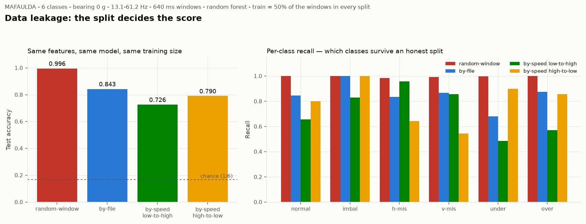

# วิธีแบ่ง train/test เปลี่ยนคะแนนไปแค่ไหน (Checkpoint 2 ขั้น 6)

- วันที่: 2026-09-25
- สคริปต์: `src/models/leakage_demo.py`
- ข้อมูล: 120 ไฟล์ · 840 หน้าต่าง · หน้าต่างละ 32768 แถว (640 ms) · 7 หน้าต่างต่อไฟล์
- ขอบเขต: 6 คลาส · bearing มวล 0 g · imbalance ทุกมวล · ความเร็ว 13.1–61.2 Hz
- feature: 66 ตัว (11 ตัว × 6 ช่อง ไม่รวม mic)
- โมเดล: random forest 300 ต้น ค่าอื่นเป็นค่าเริ่มต้น
- **ทุกวิธีเทรนด้วยข้อมูล 50% เท่ากัน** สองวิธีแรกสุ่มซ้ำ 5 ครั้ง

## ผล

| วิธีแบ่ง | accuracy | sd | macro-F1 | หน้าต่างที่ใช้เทรน |
|---|---:|---:|---:|---:|
| `random-window` | **0.996** | 0.005 | 0.996 | 420 |
| `by-file` | **0.843** | 0.053 | 0.845 | 420 |
| `by-speed low-to-high` | **0.726** | — | 0.728 | 420 |
| `by-speed high-to-low` | **0.790** | — | 0.798 | 420 |

เดาสุ่มได้ 0.167

## recall รายคลาส

| คลาส | `random-window` | `by-file` | `by-speed low-to-high` | `by-speed high-to-low` |
|---|---:|---:|---:|---:|
| normal | 1.00 | 0.85 | 0.66 | 0.80 |
| imbalance | 1.00 | 1.00 | 0.83 | 1.00 |
| horizontal-misalignment | 0.99 | 0.83 | 0.96 | 0.64 |
| vertical-misalignment | 0.99 | 0.87 | 0.86 | 0.54 |
| underhang | 1.00 | 0.68 | 0.49 | 0.90 |
| overhang | 1.00 | 0.88 | 0.57 | 0.86 |

## confusion matrix ของ `by-speed low-to-high`

แถว = ของจริง คอลัมน์ = ที่ทาย

| จริง \ ทาย | normal | imbal | h-mis | v-mis | under | over |
|---|---:|---:|---:|---:|---:|---:|
| normal | 46 | 0 | 9 | 15 | 0 | 0 |
| imbal | 0 | 58 | 0 | 12 | 0 | 0 |
| h-mis | 0 | 0 | 67 | 3 | 0 | 0 |
| v-mis | 0 | 0 | 10 | 60 | 0 | 0 |
| under | 1 | 0 | 27 | 1 | 34 | 7 |
| over | 0 | 0 | 0 | 21 | 9 | 40 |

## อ่านผลยังไง

**1. การสุ่มหน้าต่างเติมคะแนนให้ฟรี 15 จุด** (0.996 เทียบกับ 0.843) ไม่ได้แปลว่าโมเดลเก่งขึ้น แต่แปลว่าชุดทดสอบมีหน้าต่างพี่น้องจากไฟล์เดียวกันกับที่เทรนไปแล้ว หน้าต่างสองอันที่ห่างกัน 0.64 วินาทีในไฟล์เดียวกันมาจากเครื่องตัวเดียวกัน ความเร็วเดียวกัน การประกอบเดียวกัน โมเดลแค่จำไฟล์ได้ก็ตอบถูก

**2. แม้แบ่งตามไฟล์แล้วก็ยังพองอยู่อีกชั้น** พอบังคับให้ทดสอบที่ความเร็วที่ไม่เคยเห็น คะแนนตกจาก 0.843 เหลือ 0.726 ส่วนต่างก้อนนี้คือส่วนที่โมเดลอาศัยความเร็วรอบ ไม่ใช่ความเสียหาย ซึ่งเป็น leakage คนละช่องทางกับหน้าต่างติดกัน และเป็นช่องทางที่ระบบจริงเจอแน่นอน

**3. สองทิศไม่เท่ากัน** เทรนความเร็วต่ำแล้วทดสอบสูงได้ 0.726 แต่เทรนความเร็วสูงแล้วทดสอบต่ำได้ 0.790 ที่ความเร็วสูงความเสียหายถูกกระตุ้นแรงกว่า ตัวอย่างที่เทรนจึงมีสัญญาณชัดกว่า **ถ้าเก็บ training set ได้ช่วงเดียว ให้เลือกเก็บตอนเครื่องทำงานหนัก**

**4. คลาสที่รอดทุกวิธีคือ imbalance** ตรงกับที่คัดกรองลายเซ็นไว้ว่าสัดส่วนพลังงานที่ 1× เพิ่มตามมวลอย่างเป็นระบบ ส่วน bearing สองฝั่งตกหนักที่สุดและไปสับสนกับ misalignment ดูใน confusion matrix ข้างบน

## ข้อจำกัดที่ยังเหลือ

การแบ่งตามไฟล์ **ยังไม่ใช่การแบ่งที่ซื่อสัตย์ที่สุด** เพราะไฟล์ทุกไฟล์ในกลุ่มย่อยเดียวกันน่าจะบันทึกรวดเดียวในการติดตั้งครั้งเดียว การแบ่งที่ซื่อสัตย์จริงต้องแบ่งข้าม**รอบบันทึก** หรือข้ามเครื่องจักร ซึ่ง MAFAULDA ไม่ได้บันทึกไว้ว่าไฟล์ไหนมาจากการประกอบครั้งไหน ดังนั้นตัวเลข 0.843 เองก็ยังเป็นค่าที่สูงเกินจริง

**สิ่งที่ต้องรายงานคู่กับ accuracy เสมอคือวิธีแบ่ง train/test** ตัวเลขเดียวกันบนข้อมูลชุดเดียวกันต่างกันได้ 27 จุด แค่เปลี่ยนวิธีแบ่ง

