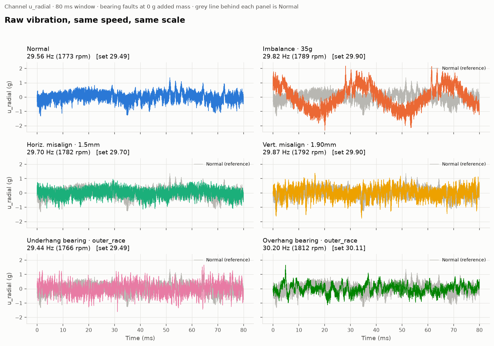
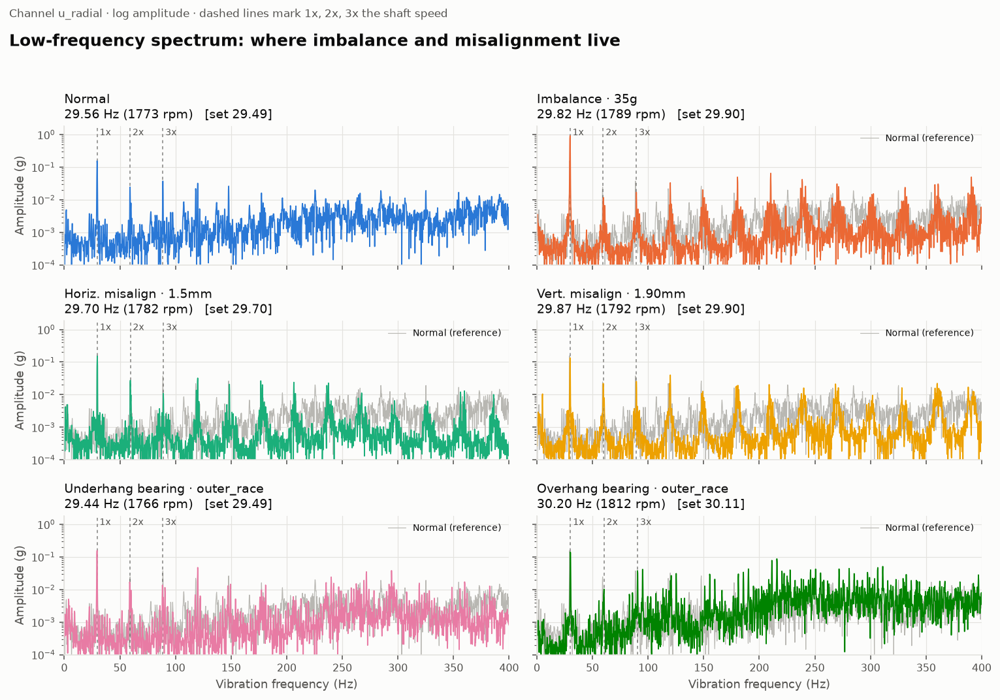
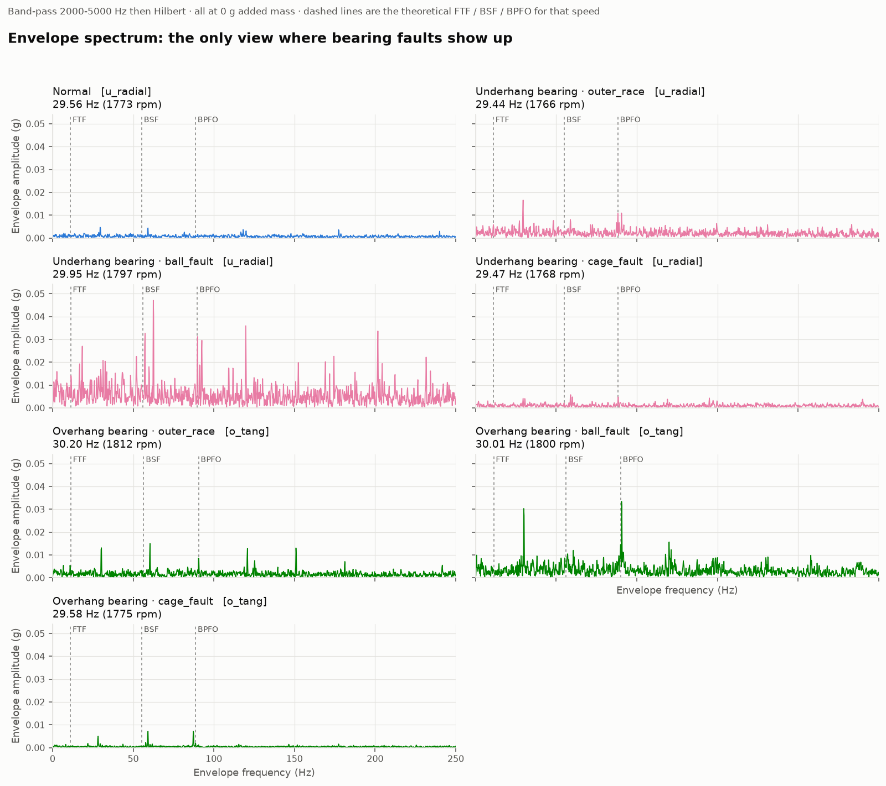
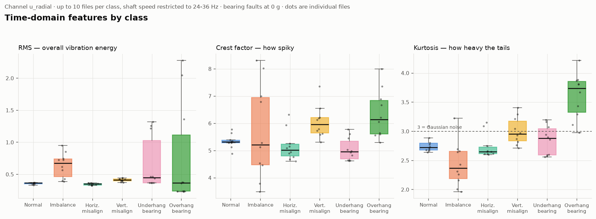
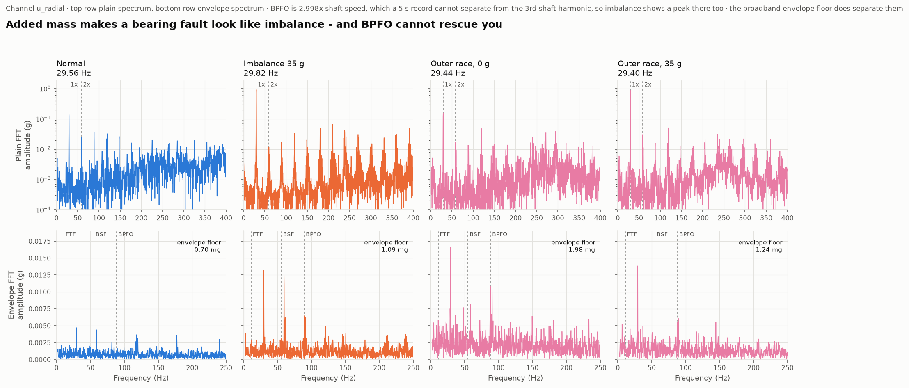
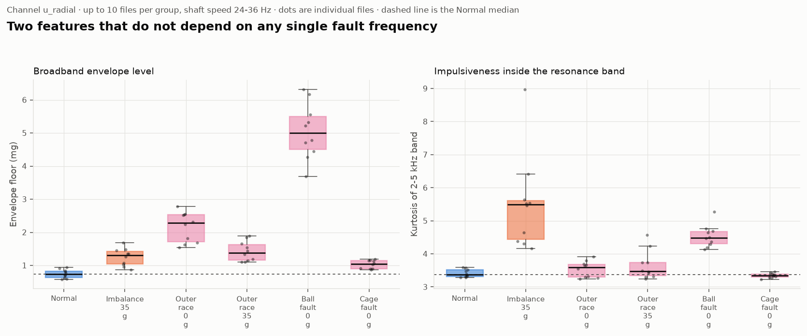
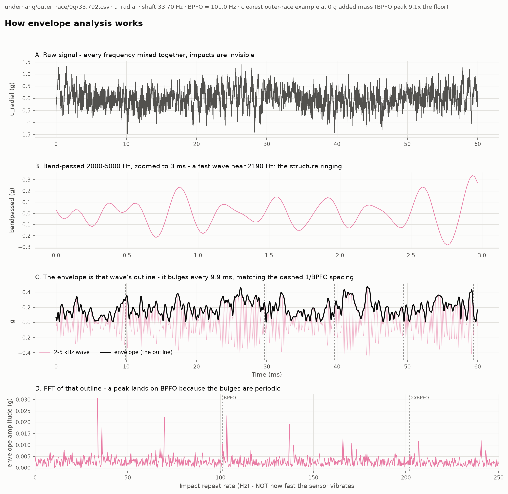

# สำรวจข้อมูล MAFAULDA — ภาพรวมทั้ง 6 คลาส

สร้างด้วย `python src/viz/make_eda_report.py` (2026-09-20)
สร้างใหม่ที่ความเร็วอื่นได้ด้วย `--target-hz 45`

---

## อ่านกราฟยังไง — เปิดรูปมาแล้วมองตรงไหนก่อน

ตารางนี้คือทางลัด รายละเอียดของแต่ละรูปอยู่ถัดลงไป

| รูป | ดูตรงไหน | คีย์ที่ต้องจับ |
|---|---|---|
| **01** สัญญาณดิบ | รูปร่างของเส้นใน 80 ms | มี**คลื่นช้าๆ** โผล่ใต้ noise ไหม |
| **02** สเปกตรัมย่านต่ำ | ความสูงของเส้นประ 1×, 2×, 3× และระดับพื้น | พีคไหน**สูงขึ้น** และพื้น**ยกขึ้น**ไหม |
| **03** envelope spectrum | มีพีคไหม และ**พื้นยกไหม** | **normal ต้องราบเรียบ** ⚠️ แต่พีคที่เห็นเป็นฮาร์มอนิกของความเร็วรอบ ไม่ใช่ความถี่ตลับลูกปืน |
| **04** feature โดเมนเวลา | กล่องเหลื่อมกับกล่อง normal ไหม | เหลื่อมเกือบหมด = **ใช้ feature ตัวเดียวไม่พอ** |
| **05** กับดัก imbalance | แถวบน คอลัมน์ 2 เทียบคอลัมน์ 4 | **หน้าตาเหมือนกันทั้งที่เสียคนละแบบ** |
| **06** feature คู่ | กล่องลอยพ้นเส้นประไหม ดูสองแผงพร้อมกัน | เครื่องหมายผ่าน**สลับกัน** = ต้องใช้คู่กัน |

### ลายเซ็นของความเสียหายแต่ละชนิด

จำสี่บรรทัดนี้ได้ก็อ่านกราฟทุกใบในโฟลเดอร์นี้ออก

| ความเสียหาย | ลายเซ็น | ช่องที่ควรใช้ | เห็นได้จากรูป |
|---|---|---|---|
| **Imbalance** | พีค **1×** สูง 8 เท่า + อัตราส่วน 2×/1× **ลดลง** | `u_tang`, `o_tang` | 01, 02, 06 |
| **Misalignment** | อัตราส่วน **2×/1× เพิ่มขึ้น 2–5 เท่า** | **`o_tang` เท่านั้น** | ดูตาราง §02 |
| **Outer race / Ball fault** | **พื้นสัญญาณยกขึ้นทั้งย่าน** + envelope floor สูง ⚠️ ไม่ใช่ความสูงของพีค | `u_radial`, `o_tang` | 02, 03, 06, 07 |
| **Cage fault** | **ยังไม่มีลายเซ็นที่จับได้เลย** | — | 03, 06 |

🚨 **ข้อจำกัดใหญ่ที่สุดของ dataset นี้** ความถี่ความเสียหายของตลับลูกปืน (BPFO/BSF/FTF)
**ไม่เคยเป็นพีคเด่นใน envelope spectrum เลยสักไฟล์เดียว** พีคเด่นเป็นฮาร์มอนิกของความเร็วรอบเสมอ
ดูหลักฐานในรูปที่ 07 → **ห้ามใช้ความสูงของพีคที่ BPFO/BSF เป็นหลักฐานของความเสียหาย**

⚠️ และ `envelope floor` **ไม่ได้เจาะจงกับตลับลูกปืน** — misalignment 2.0 mm ก็ดันขึ้นสูงกว่า
outer race ทุกกลุ่ม ใช้บอกได้แค่ว่า "ผิดปกติ" ไม่ใช่ "ผิดปกติแบบไหน" ดูรูปที่ 06

⚠️ **ช่องเซ็นเซอร์สำคัญพอๆ กับ feature** กราฟ 01–05 ใช้ `u_radial` ทั้งหมด ซึ่ง
**มองไม่เห็น misalignment เลย** ต้องดู `o_tang` ถึงจะเห็น ดูตัวเลขในหัวข้อ 02

**กลไกสองแบบที่ต่างกันโดยสิ้นเชิง** ที่ต้องแยกให้ออกคือ

- imbalance กับ misalignment ประกาศตัวด้วย **พีคที่ตำแหน่งเฉพาะ** เพราะเป็นแรงที่เกิดซ้ำเป็นจังหวะตายตัวต่อรอบ
- bearing fault ประกาศตัวด้วย **พื้นที่ยกขึ้นทั้งย่าน** เพราะเป็นการกระแทกสั้นๆ ที่กระจายพลังงานไปทั่วทุกความถี่

ด้วยเหตุนี้ **การตั้ง threshold ที่ความถี่ใดความถี่หนึ่งจึงจับ bearing fault ไม่ได้** ต้องวัดระดับพื้นแทน

---

### 🚨 แกน X ที่เขียนว่า "Frequency" หมายถึงคนละอย่างกันในแต่ละรูป

สับสนง่ายที่สุดในชุดนี้ เพราะใช้คำเดียวกันแต่คนละความหมาย

| ป้ายบนแกน X | รูป | หมายถึง | **90 Hz แปลว่า** |
|---|---|---|---|
| `Vibration frequency (Hz)` | 02, **05 แถวบน** | ความถี่ที่**เซ็นเซอร์สั่นจริงๆ** | มีอะไรสั่นไปกลับ 90 ครั้ง/วินาที |
| `Impact repeat rate (Hz)` | 03, **05 แถวล่าง**, 07 แผง D | ความถี่ที่**ความดังของการสั่นเต้น** | การสั่น 2–5 kHz **ดังขึ้นแล้วเบาลง** 90 ครั้ง/วินาที |

**รูปที่ 05 มีทั้งสองแบบอยู่ในรูปเดียวกัน** แถวบนกับแถวล่างจึงมีป้ายแกนคนละอัน
อย่าอ่านป้ายใต้แถวล่างว่าเป็นป้ายร่วมของทั้งคอลัมน์

**ในรูปที่ 03 ไม่มีอะไรสั่นที่ 90 Hz เลย** ตัวที่สั่นจริงอยู่ที่ราว **2,200 Hz**
ส่วน 90 Hz คือ**จังหวะที่มันถูกกระแทกซ้ำ** ดูรูปที่ 07 ที่แยกให้เห็นทีละขั้น

---

## 00a–00d — สัญญาณดิบทุกช่องเซ็นเซอร์

แยกไปอยู่ในเอกสารของตัวเองที่ **[README-raw-channels.md](README-raw-channels.md)**
รวมตารางยืนยันหลายไฟล์ การวิเคราะห์จุดเด่นของแต่ละรูป และคำอธิบายว่าทำไม
misalignment ถึงดู "นิ่งกว่า" normal ในช่อง `o_axial`

---

## กติกาที่ใช้กับทุกกราฟในโฟลเดอร์นี้

**1. คุมความเร็วรอบก่อนเสมอ** แรงจากมวลไม่สมดุลโตตามความเร็วรอบ**ยกกำลังสอง**
ถ้าเอา normal ที่ 15 Hz ไปเทียบกับ imbalance ที่ 55 Hz แล้วบอกว่า "imbalance สั่นแรงกว่า 13 เท่า"
ก็ไม่ได้วัดความเสียหายเลย วัดแต่ความเร็ว ทุกกราฟจึงเลือกไฟล์ที่ใกล้ **30 Hz (1800 rpm)** ที่สุด
ของแต่ละคลาส แล้วพิมพ์ความเร็วกำกับบนหัวแผงให้ตรวจสอบได้

**1ก. 🚨 sampling rate ที่ถูกคือ 51,200 Hz ไม่ใช่ 50,000 Hz** (แก้เมื่อ 2026-09-20)

เอกสาร MAFAULDA เขียนว่า 50 kHz แต่พิสูจน์จากข้อมูลแล้วว่าไม่ใช่ — ถ้าใช้ 50 kHz
ความเร็วที่นับจาก tachometer จะต่ำกว่าชื่อไฟล์ 2.33% อย่างเป็นระบบทุกไฟล์
พอใช้ 51,200 Hz อัตราส่วนกลายเป็น **1.000089** และทุกคลาสลงที่ 1.000 หมด

51.2 kHz คือ sampling rate สูงสุดของ NI 9234 ที่ใช้บันทึก ซึ่งอยู่ในรายการอุปกรณ์ของ dataset เอง

| สิ่งที่เอกสารบอก | ค่าที่ถูก |
|---|---|
| 50,000 Hz | **51,200 Hz** |
| 5.0 วินาทีต่อไฟล์ | **4.8828 วินาที** |
| ความละเอียด FFT 0.2 Hz | **0.2048 Hz** |

**กราฟทุกใบก่อนหน้านี้มีแกนความถี่คลาดไป 2.4%** ชุดนี้แก้แล้ว
รายละเอียดอยู่ใน `experiments/2026-09-20-sampling-rate.md`

> **สิ่งที่เคยเข้าใจผิดระหว่างทาง** ตอนแรกเห็นส่วนต่าง 2.33% แล้วสรุปว่าเป็น
> **slip ของมอเตอร์เหนี่ยวนำ** ซึ่งผิด เพราะ `ความเร็ว = fs / แถวต่อรอบ`
> ดังนั้น `fs` ที่ใส่ผิดให้ลายเซ็นเหมือน slip ทุกประการ
> ตัวแยกแยะคือ ถ้าเป็น slip จริง คลาสที่ถ่วง 35 g ต้อง slip มากกว่า 0 g
> แต่ของจริงทุกคลาสได้ 1.000 เท่ากันหมด
>
> **ข่าวดีคือชื่อไฟล์เป็น ground truth ที่เชื่อถือได้จริง คลาดเฉลี่ยแค่ 0.24%**

**2. bearing fault ใช้เฉพาะไฟล์มวลถ่วง 0 g** ไฟล์ที่มวล > 0 g มี imbalance ผสมอยู่
ถ้าเอามาพล็อตจะเห็นพีคใหญ่ที่ 1× แล้วเข้าใจผิดว่าเป็นผลของตลับลูกปืน

**3. แกน y ใช้ร่วมกันทุกแผงในรูปเดียวกัน** ถ้าปล่อยให้แต่ละแผง autoscale
สัญญาณที่เล็กกว่าสิบเท่าจะดูใหญ่เท่ากัน ซึ่งเป็นการโกหกด้วยกราฟ

**4. ใช้ช่อง `u_radial` เป็นหลัก** เลี่ยง `o_radial` ที่สัญญาณต่ำผิดปกติ และเลี่ยง `mic`
ที่สเกลในคลาส imbalance สูงกว่าคลาสอื่น 88 เท่า

---

## 01 — สัญญาณดิบ

> **ดูตรงไหน:** ดูที่ **"รูปร่าง" ไม่ใช่ "ความสูง"** ทุกแผงใช้แกน y เท่ากันอยู่แล้ว
> สิ่งที่ต้องมองคือมีโครงสร้างอะไรโผล่ออกมาจากกลุ่ม noise หรือเปล่า

หน้าต่าง 80 ms ประมาณ 2.4 รอบการหมุน เส้นเทาข้างหลังทุกแผงคือ normal ที่ความเร็วเดียวกัน

**สิ่งที่เห็น**

| คลาส | ความสูงยอดถึงยอด | ลักษณะ |
|---|---:|---|
| Normal | 2.70 g | สัญญาณรบกวนสม่ำเสมอ **มองไม่เห็นคาบเลย** |
| **Imbalance 35 g** | **4.50 g** | **เห็นคลื่นไซน์ชัดด้วยตาเปล่า** คาบราว 33 ms = 1 รอบการหมุนพอดี |
| Horiz. misalign 1.5 mm | 2.11 g | แทบทับกับเส้นเทา แยกด้วยตาเปล่าไม่ออก |
| Vert. misalign 1.90 mm | 3.15 g | แทบทับกับเส้นเทา แยกด้วยตาเปล่าไม่ออก |
| Underhang outer race 0 g | 3.27 g | ทับกับเส้นเทา แต่มี**หนามแหลมโดดๆ** แทงขึ้นเป็นครั้งคราว |
| Overhang outer race 0 g | 2.79 g | ทับกับเส้นเทา แต่มี**หนามแหลมโดดๆ** เช่นกัน |

หนามแหลมที่โผล่ในสองแถวล่างคือ**แรงกระแทกตอนลูกปืนกลิ้งผ่านรอยแตก** แต่มันจมอยู่ใน noise
จนตั้ง threshold ที่ค่าสูงสุดแล้วจับไม่ได้ — ต้องใช้ envelope analysis ในรูปที่ 03 ถึงจะดึงออกมาได้

> ⚠️ **imbalance ในรูปนี้ตรึงไว้ที่ 35 g เสมอ** ถ้าปล่อยให้เลือกจากทุกมวล ไฟล์ที่ได้
> จะเปลี่ยนไปมาทุกครั้งที่เกณฑ์การจับคู่ความเร็วขยับ แล้วคำอธิบายจะไม่ตรงกับรูป
> ตั้งค่าได้ที่ `IMBALANCE_MASS_G` ใน `src/viz/make_eda_report.py`

**บทเรียนข้อแรกของโปรเจกต์นี้อยู่ตรงนี้** ในบรรดาความเสียหาย 5 แบบ มีแค่ imbalance
ที่หนักถึง 35 g เท่านั้นที่ดูสัญญาณดิบแล้วรู้ ที่เหลือมองไม่ออกเลย
นี่คือเหตุผลที่งานนี้ต้องใช้การวิเคราะห์ความถี่ ไม่ใช่แค่ดูกราฟหรือตั้ง threshold ที่ค่าสูงสุด

---

## 02 — สเปกตรัมย่านต่ำ

> **ดูตรงไหน:** ดูสองอย่างคู่กัน **(ก) ความสูงของพีคตรงเส้นประ 1×, 2×, 3×**
> และ **(ข) ระดับพื้นของสัญญาณเทียบกับเส้นเทา** แกน y เป็น log แปลว่าขยับขึ้น
> หนึ่งขีดคือสูงขึ้น 10 เท่า

แกน y เป็น log เพื่อให้เห็นทั้งพีคใหญ่และพีคเล็กในรูปเดียว เส้นประบอกตำแหน่ง 1×, 2×, 3× ของความเร็วรอบ

**สิ่งที่เห็นในรูป (ช่อง `u_radial`)**

วัดจริงจากคลาสละ 10 ไฟล์ คุมความเร็ว 24–36 Hz เทียบเป็น**เท่าของ normal**

| คลาส | 1× | 2× | 3× | ระดับพื้น | พลังงาน 150–400 Hz |
|---|---:|---:|---:|---:|---:|
| normal | 1.00 | 1.00 | 1.00 | 1.00 | 1.00 |
| **imbalance 35 g** | **7.94** | 1.40 | 0.57 | 0.52 | 1.44 |
| horizontal-misalign | 0.98 | 0.95 | 0.56 | 0.39 | 0.66 |
| vertical-misalign | 0.99 | 0.81 | 0.72 | 0.39 | 0.84 |
| underhang bearing 0 g | 1.11 | 0.77 | 0.61 | 0.61 | 0.94 |
| **overhang bearing 0 g** | 1.14 | 0.40 | 0.42 | **1.44** | **2.35** |

- **Imbalance** พีคที่ 1× พุ่งไป **8 เท่าของ normal** เป็นลายเซ็นที่ชัดที่สุดในชุดนี้
  เพราะมวลที่ไม่สมดุลหมุนครบรอบหนึ่งก็เหวี่ยงหนึ่งครั้งพอดี
- **Overhang bearing** ไม่มีพีคเด่น แต่**ระดับพื้นยกขึ้น 1.44 เท่า และพลังงานย่าน
  150–400 Hz ขึ้น 2.35 เท่า** เพราะการกระแทกกระจายพลังงานไปทั่วทุกความถี่
- ⚠️ **Misalignment ไม่มีพีคที่ 1×, 2×, 3× สูงกว่า normal เลย** (0.98 / 0.95 / 0.56 และ 0.99 / 0.81 / 0.72)
  **ที่เคยเขียนไว้ว่า "2× กับ 3× โผล่ชัดขึ้น" ไม่ถูกต้อง** ตรวจด้วยตัวเลขจริงแล้วไม่เป็นแบบนั้น
- ✅ **แต่ misalignment แยกได้จากระดับพื้นที่ "ลดลง"** ทั้งสองแบบอยู่ที่ **0.39 เท่า** คือต่ำกว่า normal
  2.5 เท่า ซึ่งไม่ใช่ตัวเลขที่แยกไม่ได้ **แค่ไปคนละทางกับที่คาด** ในรูปที่ 02 เห็นชัดว่าเส้นเทา (normal)
  ลอยอยู่เหนือเส้นสีในย่าน 150–400 Hz ทั้งสองแผง misalign
  ⚠️ แต่ยัง**ไม่รู้กลไก**ว่าทำไมความเสียหายถึงทำให้พื้นสัญญาณลดลง ดูหัวข้อถัดไป
- ⚠️ **Underhang bearing แยกไม่ได้เช่นกัน** ในย่านความถี่ต่ำ

### ⚠️ ทำไม normal ถึงมีระดับพื้นสูงกว่าคลาสที่เสีย

คอลัมน์ระดับพื้นบอกว่า normal = 1.00 ขณะที่ misalign 0.39, imbalance 0.52, underhang 0.61
มีแค่ overhang ที่สูงกว่า **ซึ่งผิดจากสัญชาตญาณ** เพราะความเสียหายควรเพิ่ม noise ไม่ใช่ลด

วัดเพิ่มแล้วพบว่า **ความแปรปรวนภายในคลาสเดียวกันใหญ่พอๆ กับความต่างระหว่างคลาส**

| กลุ่ม | ระดับพื้น (mg) |
|---|---:|
| normal | 1.570 |
| h-misalign 1.0mm | 1.016 |
| h-misalign 2.0mm | 0.558 |
| u/outer_race 0g | 0.873 |
| u/outer_race 35g | 0.862 |

ภายใน horizontal-misalignment เองต่างกัน 1.8 เท่า ซึ่งพอๆ กับความต่างระหว่าง normal กับคลาสที่เสีย

**สมมติฐานที่น่าจะเป็นที่สุด: แต่ละคลาสต้องถอดประกอบเครื่องใหม่** เพราะต้องเปลี่ยนตลับลูกปืน
หรือเลื่อนฐานมอเตอร์ การประกอบแต่ละครั้งให้ระดับ noise พื้นฐานไม่เท่ากัน

**ถ้าจริง การเทียบระดับพื้นข้ามคลาสจะไม่น่าเชื่อถือ** ยังพิสูจน์ไม่ได้จากข้อมูลที่มี
เพราะ dataset ไม่ได้บันทึกว่าไฟล์ไหนมาจากการประกอบครั้งไหน

### misalignment ต้องดูช่อง `o_tang` และดูที่อัตราส่วน 2×/1×

สาเหตุที่รูปนี้มองไม่เห็น misalignment คือ**ใช้ช่องผิด** เพลาที่เยื้องศูนย์ถูกดัดสองครั้ง
ต่อรอบ แรงจึงออกมาทางแนวสัมผัสของฝั่งปลายเพลา ไม่ใช่แนวรัศมีฝั่งมอเตอร์

**อัตราส่วน 2×/1×** เทียบเป็นเท่าของ normal ในช่องเดียวกัน (คลาสละ 8 ไฟล์)

| คลาส | `u_axial` | `u_radial` | `u_tang` | `o_axial` | **`o_tang`** |
|---|---:|---:|---:|---:|---:|
| normal | 1.00 | 1.00 | 1.00 | 1.00 | **1.00** |
| imbalance 35 g | 0.94 | 0.16 | 0.76 | 0.11 | **0.44** ↓ |
| horizontal-misalign | 0.68 | 0.86 | 1.20 | 0.63 | **2.18** ↑ |
| **vertical-misalign** | 0.48 | 0.77 | 1.49 | 1.10 | **5.36** ↑↑ |
| underhang bearing | 1.96 | 0.71 | 1.37 | 0.67 | **1.07** |
| overhang bearing | 0.98 | 0.37 | 2.65 | 0.31 | **3.01** ↑ |

**นี่คือลายเซ็นตำราของ misalignment ที่หาไม่เจอในรูปที่ 02** และสังเกตว่า
**imbalance กับ misalignment ดันอัตราส่วนนี้ไปคนละทาง** — imbalance ทำให้ลดลง (0.44)
เพราะ 1× พุ่งขึ้น ส่วน misalignment ทำให้เพิ่มขึ้น (2.18 และ 5.36) เพราะ 2× พุ่งขึ้น
จึงเป็น feature ที่แยกสองคลาสนี้ออกจากกันได้ด้วยตัวเดียว

⚠️ แต่ **overhang bearing ก็ดันอัตราส่วนนี้ขึ้น 3.01 เท่าเหมือนกัน** จึงใช้ตัวเดียวไม่พอ
ต้องดูคู่กับ envelope floor ในรูปที่ 06 ซึ่งแยก overhang ออกได้

**ข้อสรุป: ย่านต่ำบนช่อง `u_radial` แยกได้แค่ imbalance และ overhang bearing
ส่วน misalignment ต้องย้ายไปดู 2×/1× บนช่อง `o_tang`**

---

## 03 — envelope spectrum

> **ดูตรงไหน:** ดูแค่ว่า **"มีพีคไหม"** ไม่ต้องสนความสูง แผง normal คือฐานที่ต้องจำ
> ถ้าราบเรียบ = ตลับลูกปืนยังดี ถ้ามีพีคเรียงเป็นชุด = เริ่มมีรอยแตก

bandpass 2–5 kHz → Hilbert → FFT ของ envelope ทั้ง 7 แผงใช้มวลถ่วง 0 g
ฝั่ง underhang ฟังจาก `u_radial` ฝั่ง overhang ฟังจาก `o_tang` เพราะแรงกระแทกความถี่สูง
ถูกดูดซับไปมากถ้าวัดจากอีกฝั่งของเพลา

**สิ่งที่เห็น**

| แผง | ผล |
|---|---|
| Normal | **ราบเรียบ ไม่มีพีค** — นี่คือฐานที่ต้องเทียบ |
| Underhang outer_race | มีพีคชัด แต่อยู่ที่ฮาร์มอนิกของความเร็วรอบ |
| Underhang ball_fault | พีคเยอะที่สุด และ**พื้นสัญญาณยกสูงทั้งแถบ** |
| **Underhang cage_fault** | **แทบไม่เห็นอะไรเลย** |
| Overhang outer_race | พีคคมชัด แต่เป็นฮาร์มอนิกของความเร็วรอบ ไม่ใช่ความถี่ตลับลูกปืน |
| Overhang ball_fault | พีคเด่นสองตัว |
| Overhang cage_fault | พีคเล็กมาก แต่ยังพอเห็น |

### 🚨 พีคที่เห็นเป็นฮาร์มอนิกของความเร็วรอบ ไม่ใช่ความถี่ตลับลูกปืน

**ที่เคยเขียนไว้ว่า "พีคคมชัดเป็นชุดที่ 1×, BSF, BPFO" ไม่ถูกต้อง** วัดจริงจากแผง
`overhang/outer_race` ได้พีคเรียงตามความสูงดังนี้

| อันดับ | ความถี่ | เป็น | แอมพลิจูด |
|---|---:|---|---:|
| 1 | 60.42 Hz | **2×** ความเร็วรอบ | 0.0150 |
| 2 | 30.31 Hz | **1×** | 0.0131 |
| 3 | 150.94 Hz | **5×** | 0.0131 |
| 4 | 120.83 Hz | **4×** | 0.0129 |
| 5 | 90.52 Hz | BPFO **และ 3× พร้อมกัน** | 0.0086 |

พีคที่ผมเคยชี้ว่าเป็น BSF (56.5 Hz) จริงๆ คือ **2× ที่ 60.42 Hz** ห่างกัน 4 Hz แต่กะด้วยตาแล้วแยกไม่ออก

**ตรวจทั้ง dataset แล้วพบว่านี่ไม่ใช่เรื่องบังเอิญของไฟล์นี้** จากไฟล์ `ball_fault` ที่ 0 g
ทั้ง 51 ไฟล์ พีคใหญ่ที่สุดใน envelope spectrum อยู่ที่ 3× (20 ไฟล์) / 2× (14) / 1× (10) / 10× (6) / 5× (1)
— **ไม่มีไฟล์ไหนเลยที่พีค BSF เป็นพีคใหญ่ที่สุด** และการเติมมวลถ่วงก็ไม่ช่วย (ดูรูปที่ 07)

**ข้อสรุปสามข้อ**

1. **cage fault ตรวจยากที่สุดจริงอย่างที่กลัวไว้** ทั้งสองฝั่งแทบไม่มีสัญญาณ ตรงกับที่ FTF = 0.375×
   ให้ความถี่แค่ 11 Hz ที่ 30 Hz ซึ่งต่ำและพลังงานน้อย ถ้าโมเดลจับ cage fault ไม่ได้ **อย่าเพิ่งโทษโค้ด**
2. **ฝั่ง overhang ให้พีคคมกว่าฝั่ง underhang** น่าจะเพราะตลับลูกปืน overhang อยู่ปลายเพลาที่อิสระกว่า
3. 🚨 **ห้ามใช้ความสูงของพีคที่ BPFO/BSF เป็นหลักฐานของความเสียหายใน dataset นี้**
   ให้ใช้ปริมาณที่วัดทั้งแถบแทน เช่น `envelope floor` ในรูปที่ 06 ซึ่งเป็นเหตุผลที่แท้จริงว่า
   ทำไมต้องใช้ตัวนั้น (กว้างกว่าเหตุผลเรื่อง BPFO ทับ 3× ที่เคยเขียนไว้มาก)

---

## 04 — feature โดเมนเวลา

> **ดูตรงไหน:** ดูว่ากล่องของคลาสนั้น**ลอยพ้นกล่องของ normal หรือเปล่า**
> ถ้าเหลื่อมกันแปลว่า feature ตัวนั้นแยกคลาสนั้นไม่ได้

คลาสละไม่เกิน 10 ไฟล์ คุมความเร็วไว้ที่ 24–36 Hz จุดดำคือไฟล์แต่ละไฟล์ กล่องคือ quartile

> ⚠️ **รูปนี้ใช้ imbalance ทุกมวล (6–35 g) ปนกัน** ไม่เหมือนรูป 01, 02, 05 ที่ตรึงไว้ที่ 35 g
> ค่า RMS ของ imbalance ในรูปนี้จึงเป็นค่าเฉลี่ยข้ามความรุนแรง ไม่ใช่เคสที่หนักที่สุด

| feature | สิ่งที่แยกได้ | สิ่งที่แยกไม่ได้ |
|---|---|---|
| **RMS** | imbalance ขึ้นชัด (0.67 vs 0.37) | misalignment แทบไม่ขึ้นเลย |
| **Crest factor** | overhang bearing และ vertical misalign สูงกว่า | ช่วงค่าเหลื่อมกันมาก ใช้ตัวเดียวไม่ได้ |
| **Kurtosis** | **overhang bearing เด่นที่สุด 3.7 เทียบกับ normal 2.7** | underhang bearing ยังคาบเกี่ยวกับ normal |

**จุดที่ต้องระวังในกราฟนี้** กล่องของ bearing fault ทั้งสองฝั่งสูงมากในคอลัมน์ RMS
เพราะกลุ่มตัวอย่างรวมทั้ง outer_race, ball_fault และ cage_fault ปนกัน ซึ่งมีความรุนแรงต่างกันมาก
ถ้าจะสรุปให้ละเอียดกว่านี้ต้องแยกกราฟตามชนิดความเสียหาย

**ข้อสังเกตที่มีประโยชน์จริง** kurtosis ของ normal อยู่ที่ 2.7 ต่ำกว่า 3 ซึ่งแปลว่าสัญญาณปกติ
"แบนกว่า" การแจกแจงปกติเล็กน้อย ไม่ใช่ 3 เป๊ะอย่างในตำรา ถ้าตั้ง threshold ที่ 3 ตรงๆ
จะได้ false alarm เมื่อความเร็วเปลี่ยน ต้องหาฐานจากข้อมูลจริงของเครื่องนั้นเอง

---

## 05 — กับดัก imbalance ปนใน bearing fault

> **ดูตรงไหน:** ดู**แถวบน** แล้วเทียบ **คอลัมน์ 2 (imbalance 35 g) กับคอลัมน์ 4
> (outer race 35 g)** ทั้งสองมีพีค 1× สูงเท่ากันและชุดฮาร์มอนิกเหมือนกัน
> ทั้งที่คอลัมน์หนึ่งคือมวลถ่วง อีกคอลัมน์คือรางลูกปืนแตก
> เทียบกับคอลัมน์ 3 (outer race ที่ไม่ถ่วงมวล) ที่ 1× เตี้ยเท่า normal

**นี่คือรูปที่สำคัญที่สุดในชุดนี้** สี่คอลัมน์คือ normal / imbalance 35 g /
outer race ที่ 0 g / outer race ที่ 35 g ทุกคอลัมน์ความเร็วเท่ากันหมด

**แถวบน (FFT ธรรมดา)** คอลัมน์ที่ 2 กับที่ 4 หน้าตาเหมือนกันมาก ทั้งคู่มีพีค 1× ใหญ่เท่าๆ กัน
ต่างจาก normal และจาก outer race ที่ 0 g อย่างชัดเจน
→ **ถ้าเทรนด้วย bearing fault ที่มวล 35 g เทียบกับ normal โมเดลจะเรียนรู้ "มีมวลถ่วงหรือเปล่า" ไม่ใช่ "ตลับลูกปืนเสียหรือเปล่า"**

**แถวล่าง (envelope) และสิ่งที่ค้นพบใหม่**

ตอนแรกผมคาดว่า envelope จะช่วยแยกได้ เพราะ imbalance ไม่ควรมีพีคที่ BPFO
**แต่ในรูปจริง imbalance 35 g ก็มีพีคที่เส้น BPFO เหมือนกัน** สาเหตุคือ

> **BPFO ของตลับลูกปืนตัวนี้มีตัวคูณ 2.9980 ซึ่งห่างจาก 3.0000 อยู่แค่ 0.002**
> ที่ความเร็ว 30 Hz แปลว่าห่างกัน 0.06 Hz แต่ไฟล์ยาว 4.8828 วินาทีให้ความละเอียดความถี่
> เพียง 1/4.8828 = **0.2048 Hz** ซึ่งหยาบกว่าระยะห่างถึง 3.4 เท่า
> **พีค BPFO กับฮาร์มอนิกที่ 3 ของความเร็วรอบจึงตกลงในช่องความถี่เดียวกันเสมอ แยกไม่ออก**

ตรวจแล้วเป็นแบบนี้ทุกความเร็วตั้งแต่ 12.3 ถึง 61.4 Hz ไม่ใช่เฉพาะที่ 30 Hz
(เครื่องจักรปกติทุกเครื่องมีฮาร์มอนิกของความเร็วรอบอยู่แล้ว ยิ่ง imbalance หนักยิ่งมีมาก)

**แล้วอะไรแยกได้จริง** ตัวเลข `envelope floor` มุมขวาบนของแต่ละแผงแถวล่าง
คือค่ามัธยฐานของ envelope spectrum ทั้งแถบ ซึ่งวัด "เสียงกระแทกแบบสุ่ม" ที่ไม่ใช่พีคเป็นคาบ
ในรูปนี้ได้ normal 0.70 / imbalance 1.09 / outer race 0 g **1.98** / outer race 35 g 1.24 mg

แต่นี่คือไฟล์ละหนึ่งไฟล์เท่านั้น **ยังสรุปไม่ได้** ต้องวัดหลายไฟล์ก่อน ซึ่งคือรูปที่ 06

**สรุปเป็นข้อปฏิบัติจากรูปนี้**

1. อย่าใช้ "พีคที่ BPFO" เป็นหลักฐานเดี่ยวของความเสียหายรางนอกใน dataset นี้
2. `BSF` (1.8710×) และ `FTF` (0.3750×) **ไม่มีปัญหาเรื่องทับฮาร์มอนิก** เพราะห่างจากจำนวนเต็มมากพอ
   ⚠️ แต่ดูรูปที่ 07 ก่อน — **พีค BSF ก็ไม่เคยเป็นพีคเด่นในไฟล์ไหนเลยทั้ง dataset**
   ปัญหาของ dataset นี้จึงกว้างกว่าแค่ BPFO ทับ 3×
3. ถ้าจะใช้ไฟล์ bearing fault ที่มวล > 0 g ต้องเทียบกับ imbalance ล้วนที่มวลเดียวกัน เสมอ

---

## 06 — feature ที่ไม่อิงพีคความถี่เดียว (และข้อจำกัดของมัน)

> **ดูตรงไหน:** ดูว่ากล่องแต่ละกลุ่ม**ลอยพ้นเส้นประ** (ค่ามัธยฐานของ normal)
> หรือเปล่า และต้องดู **สองแผงพร้อมกัน** ไม่ใช่ทีละแผง เพราะสองตัวนี้จับคนละอย่าง

รูปที่ 03 และ 07 บอกว่าความสูงของพีคใช้ไม่ได้ รูปนี้ทดสอบผู้สมัครสองตัวที่วัดทั้งแถบแทน
**กลุ่มละ 10 ไฟล์** คุมความเร็ว 24–36 Hz ช่อง `u_radial` **กลุ่ม bearing เป็นฝั่ง underhang ทั้งหมด**

- `envelope_floor` มัธยฐานของ envelope spectrum ทั้งแถบ = ปริมาณการกระแทกแบบสุ่ม
- `kurtosis_band` kurtosis ของสัญญาณ**หลัง bandpass 2–5 kHz** = ความแหลมของการกระแทก
- `kurtosis_raw` kurtosis ของ**สัญญาณดิบ** ซึ่งเป็นคนละตัวกับข้างบน ดูหัวข้อย่อยท้ายสุด

### ตัวเลขที่วัดได้

| กลุ่ม | envelope floor (mg) | kurtosis_band |
|---|---|---|
| Normal | 0.738 (0.58–0.94) | 3.37 (3.28–3.59) |
| Imbalance 35 g | 1.302 (0.86–1.68) | **5.50** (4.16–8.97) |
| H-misalign 1.0 mm | 0.641 (0.51–0.80) | 3.32 (3.23–3.44) |
| **H-misalign 2.0 mm** | **2.155** (1.76–2.68) | 3.61 (3.50–3.89) |
| V-misalign 1.90 mm | 1.083 (0.84–1.25) | 3.43 (3.28–3.51) |
| Underhang outer 0 g | **2.278** (1.54–2.78) | 3.59 (3.24–3.91) |
| Underhang ball 0 g | **5.001** (3.69–6.32) | **4.48** (4.14–5.27) |
| Underhang cage 0 g | 1.039 (0.86–1.19) | 3.34 (3.23–3.46) |

### แยกขาดจาก Normal หรือไม่ (ช่วงค่าไม่เหลื่อมกันเลย)

| กลุ่ม | envelope floor | kurtosis_band |
|---|---|---|
| Imbalance 35 g | ❌ | ✅ |
| H-misalign 1.0 mm | ❌ | ❌ |
| **H-misalign 2.0 mm** | ✅ | ❌ |
| V-misalign 1.90 mm | ❌ | ❌ |
| Underhang outer 0 g | ✅ | ❌ |
| Underhang ball 0 g | ✅ | ✅ |
| **Underhang cage 0 g** | ❌ | ❌ |

### 🚨 envelope floor ไม่ได้เจาะจงกับตลับลูกปืน

**รอบแรกผมทดสอบแค่ normal / imbalance / bearing สามชนิด แล้วสรุปว่า envelope floor
แยก bearing fault ได้ ซึ่งผิด** เพราะ**ตัดคลาสที่หักล้างข้อสรุปออกไปตั้งแต่ต้น**

พอใส่ misalignment เข้ามา พบว่า **h-misalign 2.0 mm มี envelope floor = 2.155 mg
ซึ่งสูงกว่า outer race ทุกกลุ่ม** และแยกขาดจาก normal ได้เหมือนกัน

> **บทเรียน: ก่อนสรุปว่า feature ตัวหนึ่งแยกคลาส A ได้ ต้องทดสอบกับทุกคลาสที่มี
> ไม่ใช่เฉพาะคลาสที่เราสนใจ** ไม่งั้นจะได้ข้อสรุปที่ดูดีเพราะเลือกชุดเปรียบเทียบเอง

**สิ่งที่ envelope floor วัดจริงๆ คือ "ปริมาณการกระแทกแบบสุ่มในย่าน 2–5 kHz"**
ซึ่งความเสียหายหลายชนิดทำให้เพิ่มขึ้นได้ ไม่ใช่แค่ตลับลูกปืน จึงใช้เป็น
**ตัวบอกว่าผิดปกติ (ชั้น 1)** ได้ แต่ใช้เป็น **ตัวบอกว่าผิดปกติแบบไหน (ชั้น 2)** ไม่ได้

⚠️ และยังมีข้อสงสัยเรื่องการประกอบเครื่องใหม่ในหัวข้อ 02 ค้างอยู่ ซึ่งกระทบตัวนี้โดยตรง

### สิ่งที่ตารางนี้ยังบอกได้

**1. สองตัวเสริมกัน** ✅ ของสองคอลัมน์แทบสลับกัน — ความเสียหายตลับลูกปืนดันระดับพื้นขึ้น
แต่ไม่ทำให้แหลมขึ้น ส่วน imbalance หนักทำตรงกันข้าม

**2. แยก outer race 35 g ออกจาก imbalance 35 g ได้** floor ใกล้กันมาก (1.385 กับ 1.302)
แต่ kurtosis_band ต่างกันชัด (3.47 กับ 5.50)

**3. cage fault ยังจับไม่ได้ด้วยทั้งสองตัว** สอดคล้องกับรูปที่ 03
**ถ้าโมเดลที่จะเทรนต่อไปจับ cage fault ไม่ได้ นี่คือสาเหตุ ไม่ใช่บั๊ก**

**4. ball fault ตรวจง่ายที่สุด** envelope floor สูงกว่า normal เกือบ 7 เท่า
เวลารายงานผลอย่าเอา accuracy รวมทุกชนิดมาอ้าง **ต้องแจกแจง recall แยกตามชนิดเสมอ**

### ⚠️ kurtosis สองตัวไปคนละทาง และอธิบายได้

รูปที่ 04 บอกว่า **imbalance มี kurtosis ต่ำที่สุด (2.37 ต่ำกว่า normal 2.72)**
แต่รูปนี้บอกว่า **kurtosis_band ของ imbalance สูงที่สุด (5.50)** — ไม่ใช่ความขัดแย้ง

| | kurtosis ดิบ | kurtosis หลัง bandpass | พลังงานที่ 1× |
|---|---:|---:|---:|
| normal | 2.771 | 3.433 | 8.0% |
| **imbalance 35 g** | **2.241** | **5.343** | **69.3%** |
| underhang outer 0 g | 2.811 | 3.314 | 6.6% |

**คลื่นไซน์บริสุทธิ์มี kurtosis = 1.500 พอดี** และ imbalance 35 g มีพลังงาน **69.3% กระจุกอยู่ที่ 1×**
คลื่นไซน์ก้อนนั้นจึงดึง kurtosis ของสัญญาณดิบลง พอ bandpass 2–5 kHz ตัดมันทิ้ง
สิ่งที่เหลือกลับแหลมที่สุดในบรรดาทุกคลาส

**นี่คือหลักฐานว่าที่ 35 g มีการกระแทกเกิดขึ้นจริงในย่านความถี่สูง** น่าจะเป็นฐานหรือคัปปลิ้ง
กระแทกเพราะสั่นแรงเกิน — **ไม่ใช่ผลของตลับลูกปืน** ซึ่งเป็นอีกเหตุผลว่าทำไมไฟล์มวล > 0 g
ถึงใช้แทนความเสียหายตลับลูกปืนไม่ได้

> ชื่อสองตัวนี้ต้องเขียนให้ต่างกันชัดเจนเสมอ — `kurtosis_raw` กับ `kurtosis_band`
> เขียนว่า "kurtosis" เฉยๆ จะสับสนทันทีเพราะสองตัวนี้ไปคนละทาง

---

## 07 — envelope analysis ทำงานยังไง

> **ดูตรงไหน:** ไล่จากแผง A ลงไป D ทีละขั้น สังเกต**หน่วยของแกน X ที่เปลี่ยนความหมาย**
> ตอนข้ามจากแผง C ไป D

รูปนี้มีสองหน้าที่ — อธิบายว่า envelope คืออะไร และ**แสดงข้อจำกัดที่ใหญ่ที่สุดของ dataset นี้**

ใช้ไฟล์ `underhang/ball_fault/0g/29.9008.csv` ซึ่งเป็นไฟล์ที่**พีค BSF เด่นที่สุดในทั้ง dataset**
เทียบกับพีคที่สูงที่สุดในสเปกตรัมของตัวเอง

> **ทำไมใช้ `ball_fault` ไม่ใช้ `outer_race`** เพราะ BPFO = 2.998× ทับกับฮาร์มอนิกที่ 3
> ของความเร็วรอบจนแยกไม่ได้ (ห่างกัน 0.067 Hz ขณะที่ความละเอียดคือ 0.2048 Hz)
> รูปที่ใช้ outer_race จึงพิสูจน์อะไรไม่ได้เลย — พีคที่โผล่มาเป็นฮาร์มอนิกของความเร็วรอบทั้งหมด
> ส่วน **BSF = 1.871× ห่างจากจำนวนเต็มที่ใกล้ที่สุดถึง 13 ช่องความถี่** จึงเป็นพีคที่
> **เป็นของตลับลูกปืนแน่นอน**

### เปรียบเทียบให้เห็นภาพ: การเคาะระฆัง

- ระฆังดัง "หง่างงง..." ที่**เสียงสูง** — เทียบได้กับโครงสร้างเครื่องจักรที่สั่นราว 2,200 Hz
- ถ้าเคาะซ้ำทุกครึ่งวินาที จะได้ "หง่าง หง่าง หง่าง" — **เสียงยังสูงเหมือนเดิม
  แต่ความดังเต้นเป็นจังหวะ 2 ครั้ง/วินาที**

**envelope คือเส้นที่ลากตามความดัง ไม่ใช่ตัวเสียง** พอเอาเส้นนั้นมาทำ FFT อีกทีจะได้ 2 Hz
ซึ่งคือ**จังหวะการเคาะ** ไม่ใช่ความถี่ของเสียง

ในตลับลูกปืน รอยแตกบนลูกปืน "เคาะ" โครงสร้างให้สั่นแล้วซาลง พอหมุนครบรอบก็เคาะอีก
**ในรูปนี้เพลาหมุน 29.95 Hz ลูกปืนจึงเคาะทุก 17.8 ms = 56 ครั้ง/วินาที = BSF พอดี**

### สี่ขั้นในรูป

| แผง | ทำอะไร | เห็นอะไร |
|---|---|---|
| **A** | สัญญาณดิบ 60 ms | ทุกความถี่ปนกันหมด มองไม่ออกว่ามีการกระแทก |
| **B** | bandpass 2–5 kHz แล้วซูมเหลือ 3 ms | คลื่นเร็วราว **3,030 Hz** คือความถี่ที่โครงสร้างสั่น |
| **C** | ลากเส้นขอบด้วย Hilbert transform | เส้นดำโป่งขึ้นทุก **17.8 ms** ตรงกับเส้นประที่ระยะ 1/BSF |
| **D** | FFT ของเส้นขอบ | มีพีคที่ **BSF = 56 Hz** จริง แต่**สูงแค่ 58% ของพีคที่สูงที่สุด** |

### 🚨 ข้อจำกัดที่ใหญ่ที่สุด: ความถี่ตลับลูกปืนไม่เคยเป็นพีคเด่น

ตรวจ **ไฟล์ `ball_fault` ที่ 0 g ทั้ง 51 ไฟล์** แล้วดูว่าพีคใหญ่ที่สุดใน envelope spectrum อยู่ที่ไหน

| พีคใหญ่ที่สุดอยู่ที่ | จำนวนไฟล์ |
|---|---:|
| 3× ของความเร็วรอบ | 20 |
| 2× | 14 |
| 1× | 10 |
| 10× | 6 |
| 5× | 1 |
| **BSF** | **0** |

และการเติมมวลถ่วงก็**ไม่ช่วย** — พีค BSF ที่ดีที่สุดเทียบกับพีคเด่นได้ 0.58 (0 g) / 0.68 (6 g) /
0.47 (20 g) / 0.41 (35 g) ทุกมวล ทุกฝั่ง พีคเด่นเป็นอย่างอื่นเสมอ

> **ใน MAFAULDA ความถี่ความเสียหายของตลับลูกปืนไม่เคยเป็นพีคเด่นใน envelope spectrum เลย**
>
> ไม่ใช่เพราะเลือกไฟล์ไม่ดี รูปนี้ใช้ไฟล์ที่ดีที่สุดที่มีอยู่แล้ว
> **นี่คือเหตุผลที่แท้จริงว่าทำไมต้องใช้ `envelope floor` ที่วัดทั้งแถบ แทนความสูงของพีค**
> (กว้างกว่าเหตุผลเรื่อง BPFO ทับ 3× ที่เขียนไว้ในหัวข้อ 05 มาก)

⚠️ **แผง C ดูรก** เพราะแรงกระแทกจมอยู่ใน noise เส้นดำโป่งเป็นคาบจริง แต่ไม่สวยเหมือนในตำรา
**นี่คือสภาพข้อมูลจริง** และเป็นเหตุผลว่าทำไมต้องพึ่ง FFT ในแผง D แทนการดูด้วยตา

### ทำไม FFT ธรรมดาถึงหาไม่เจอ

เพราะ **ไม่มีคลื่นความถี่ 56 Hz อยู่ในสัญญาณจริงๆ** สิ่งที่มีคือคลื่น 3,030 Hz ที่ดังๆ เบาๆ
FFT ธรรมดาจะเห็นแค่ก้อนพลังงานแถว 2 kHz แล้วบอกไม่ได้ว่ามันเต้นเป็นจังหวะเท่าไหร่
ต้องดึงเส้นขอบออกมาก่อนแล้วค่อยทำ FFT อีกที

โค้ดอยู่ใน `src/features/spectral.py` ฟังก์ชัน `envelope_spectrum()`

---

## ขั้นถัดไป (สถานะ ณ 2026-10-05)

1. ✅ **เสร็จแล้ว** `src/data/tachometer.py` แปลงพัลส์เป็น rpm และตรวจผ่านเกณฑ์ ±1%
   ครบ 49 จาก 49 ไฟล์ **และเป็นขั้นตอนที่ทำให้พบว่า sampling rate จริงคือ 51,200 Hz**
   ความเร็วของทุกไฟล์เก็บไว้ที่ `data/interim/mafaulda_speed.csv`
   → **กราฟในโฟลเดอร์นี้สร้างก่อนหน้านั้น จึงยังใช้ความเร็วจากชื่อไฟล์**
   ซึ่งตรวจแล้วว่าคลาดจากที่วัดได้เพียง 0.24% จึงไม่กระทบข้อสรุปของกราฟ
2. ✅ **เสร็จแล้วในรูปแบบที่ดีกว่า** แทนที่จะทำกราฟแนวโน้มแยก กลายเป็น
   `src/viz/bubble_grid.py` ซึ่งดูได้ทุก feature × ทุกช่อง × ทุกความรุนแรง
   ในภาพเดียว และ `src/features/check_signature_persistence.py` ที่ทดสอบว่า
   ลายเซ็นคงอยู่ข้ามระดับความรุนแรงหรือไม่
3. ⬜ **ยังไม่ได้ทำ** ตรวจสมมติฐานว่าสเกล `mic` ในคลาส imbalance ที่สูงผิดปกติ
   88 เท่าเกิดจาก gain ของ preamp หรือเสียงจริง

   ⚠️ **เรื่องนี้สำคัญขึ้นหลังทบทวนวรรณกรรม** เพราะงานวิจัยสองฉบับพบว่า `mic`
   เป็นช่องที่**ดีที่สุด** (Ūselis ได้ 96.02% ชนะทุกช่องสั่นสะเทือน) ขณะที่เราตัด
   ช่องนี้ทิ้งทั้งช่อง การตัดทิ้งอาจเป็นการตัดสินใจที่ผิด
   ดู `paper/literature-review.md` ฉบับ 06

### เกิดขึ้นหลังจากกราฟชุดนี้

กราฟในโฟลเดอร์นี้เป็นผลของ Checkpoint 2 งานที่ตามมาคือ

| งาน | ผลอยู่ที่ |
|---|---|
| ระบบรับส่งข้อมูล MQTT → InfluxDB → Grafana | `docs/data-pipeline-design.md` |
| ตัวตรวจจับความผิดปกติ 3 ชั้น | `experiments/2026-10-04-anomaly-detector.md` |
| กราฟเส้นเกณฑ์และแนวโน้มรายวัน | `reports/trend/` |
| ทบทวนวรรณกรรม 11 ฉบับ | `paper/literature-review.md` |
